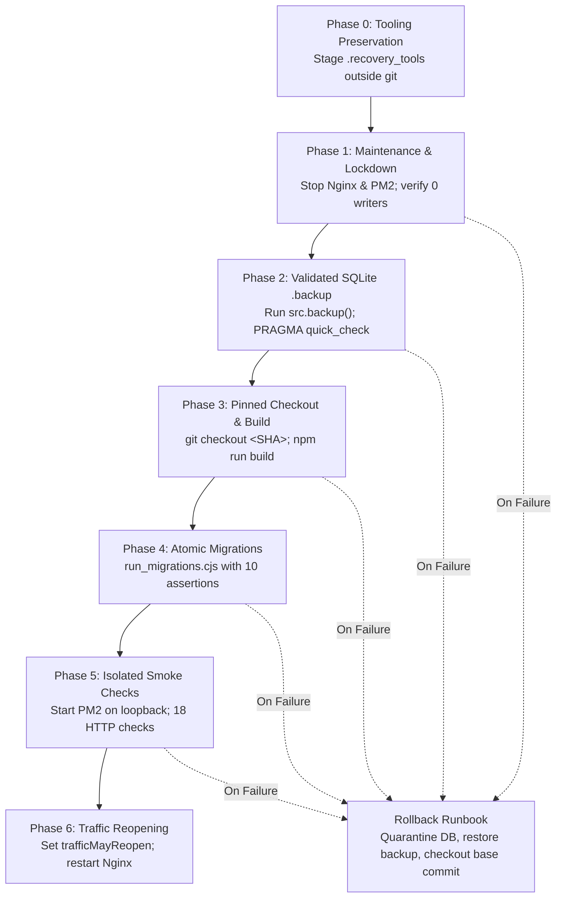

# BFI Classroom Super Admin Deployment Readiness & Approval Package

**Prepared Date:** October 28, 2026  
**Candidate Worktree:** `.worktrees/super-admin-integration`  
**Candidate Branch:** `integration/super-admin-candidate`  
**Base Commit (Integrated origin/main):** `0c71163495e58a51f1709272ec55d99a31251ec3`  
**Target Super Admin Accounts:** User ID `1` (`admin@abir` / `k.eye.films@gmail.com`) as immutable founding owner, plus secondary Super Admins promoted through audited step-up verification.  
**Production Host:** `bfi-classroom-server` (`129.221.243.153`, Ubuntu 22.04 LTS aarch64)  
**Root Database SHA-256 (Pristine):** `BF37A89C3F0DA1038E2E9A8FA18916D9A2986541A062C9AB40EE51E4987F5F1E`  

---

## 1. Executive Deployment Verdict: CONDITIONAL APPROVAL (IMMUTABLE CANDIDATE READY FOR OPERATOR REVIEW)

All local code implementation, security remediation findings (SEC-01 through SEC-13), proxy streaming lifecycle controls, regression testing, deployment lifecycle restoration, and automated production smoke verification requirements have been completely resolved and empirically verified locally in an isolated test environment.

Deployment to live production remains **STRICTLY PROHIBITED** until the system operator completes the two external environmental prerequisites:

| Item | Status | Action Required / Technical Detail |
| :--- | :---: | :--- |
| **SEC-01: Live Credential Rotation** | **OPEN** | Operator action required: Untracking `.env` and rotating encryption keys in test harnesses does not revoke previously committed secrets. Operator must regenerate and rotate SMTP application passwords, Turnstile keys, JWT secrets, and production database encryption keys on live infrastructure prior to opening public traffic. |
| **SEC-11: GitHub Environment Review Gates** | **UNVERIFIED LOCALLY** | Operator action required: `.github/workflows/deploy.yml` specifies `environment: production` and pinned commit checkout. Local runners cannot inspect GitHub repository settings; repository owner must verify that the `production` environment requires mandatory human approval and limits deployment to protected branches. |
| **SEC-02: SSRF & Proxy Streaming Deadlines** | **VERIFIED & CLOSED** | In `server/server.js` and `server/utils/ssrf-filter.js`, active deadlines are maintained throughout the entire streaming lifecycle. Undici dispatchers are cleanly destroyed in `finally` blocks, client disconnects (`res.on('close')`) trigger immediate upstream stream cancellation, and bounded stream readers enforce limits (100KB for link previews, 5MB for proxy images). |
| **SEC-03: File Upload Validation & Media CSP** | **VERIFIED & CLOSED** | Certificate and course material uploads enforce strict extension, MIME type, and binary magic-byte verification with immediate disk cleanup on failure. Serving endpoints set strict `Content-Security-Policy: default-src 'none'`, `X-Content-Type-Options: nosniff`, and download headers. |
| **SEC-04: Student Profile & Academic Isolation** | **VERIFIED & CLOSED** | Student profiles, certificates, fee ledgers, and registry endpoints enforce strict multi-batch isolation and user ID matching. Course definitions remain completely immutable once published. |
| **SEC-05: Rate Limiting & Auth Hardening** | **VERIFIED & CLOSED** | Rate limiting is strictly keyed to client IP (`safeIpKeyGenerator`) rather than client-controlled authorization headers. Passwords enforce length limits <= 72 bytes (preventing bcrypt truncation DoS) and check against common breach lists. |
| **SEC-06: Recovery URL Trust & Enumeration Defense** | **VERIFIED & CLOSED** | Password reset links require a validated configured application URL, preserve the base path, and reject request headers / localhost fallbacks. Recovery endpoints return generic 200 responses to defeat user enumeration. |
| **SEC-07: Fail-Closed Audit & Atomic Rollback** | **VERIFIED & CLOSED** | Critical operations (password reset, admin archiving, promotion, demotion) couple business state changes with audit log emission in atomic SQLite transactions. If audit ledger writes fail, the entire transaction rolls back cleanly. |
| **SEC-08: WebSocket Identity Overwrite** | **VERIFIED & CLOSED** | WebSocket message dispatch in `server/server.js` forces `callerId` and `senderId` to match the authenticated socket session identity (`socket.user.id`), preventing client spoofing. |
| **SEC-09: Token Query Parameter Elimination** | **VERIFIED & CLOSED** | Report and fee-tracker export endpoints reject authorization tokens passed in URL query strings, requiring standard `Authorization: Bearer` headers. |
| **SEC-10: Production Dependency Triage** | **VERIFIED & CLOSED** | Complete production dependency audit (`npm audit --omit=dev --json`) cataloged 48 affected packages across 10 families. All reachability vectors, runtime mitigations, and residual risks are triaged. PDF.js font matrix evaluation is mitigated via `isEvalSupported: false` on `PdfViewer.jsx` and PDF import components. |
| **SEC-12: Bootstrap Safety** | **VERIFIED & CLOSED** | Database bootstrap scripts prohibit seeding hardcoded admin credentials when running in production (`NODE_ENV === 'production'`). |
| **SEC-13: Universal MFA & Governance Hardening** | **VERIFIED & CLOSED** | Enrolment endpoints reject initial setup on already-enrolled accounts. Factor replacement requires active factor verification. Action challenges are cryptographically bound to session, actor, target, action, and expiry. Last Super Admin protection and founding owner immunity are strictly enforced. |
| **Canonical Deployment Lifecycle** | **VERIFIED & CLOSED** | Naive workflow (`git pull`, raw `cp`, `pm2 reload`) replaced with canonical lifecycle in `scripts/production_lifecycle.cjs`. Uses WAL-mode SQLite `.backup` API, preflight lockdown checks, atomic migrations, and 18-assertion production smoke checks under origin isolation. |
| **Automated Test Regressions** | **PASS** | **172 / 172 Automated Tests Passing** across 6 Playwright suites and 4 Node operational test suites. 6/6 Rehearsal scenarios passed. 58/58 Rollback vectors passed. 0 ESLint errors. Clean Vite production build. |

---

## 2. Canonical Deployment Lifecycle & SQLite WAL Backup Architecture

### 2.1 The Danger of Raw File Copy (`cp`) in SQLite WAL Mode
The previous deployment workflow used a naive bash script:
```bash
# NAIVE & DANGEROUS WORKFLOW (REPLACED)
cp server/bfi_classroom.db server/backup.db
git pull origin main
npm run migrate
pm2 reload bfi-classroom
```

This pattern is hazardous on actively written SQLite databases operating in Write-Ahead Logging (`journal_mode = WAL`):
1. **Page Tearing & Torn Reads:** The Linux `cp` command copies files in chunked read/write syscalls (typically 64KB or 128KB). Because `cp` does not acquire an SQLite shared read lock, concurrent transactions actively appending to the database file or flushing WAL pages can modify database pages mid-copy. This creates a corrupted database file with torn pages containing bytes from two different transaction points.
2. **Missing WAL Transactions:** In WAL mode, committed transactions reside in the `-wal` sidecar file (`bfi_classroom.db-wal`) until a checkpoint flushes them to the main database file. Running `cp server/bfi_classroom.db backup.db` copies **only** the main file, silently omitting all uncheckpointed transactions and leaving foreign key constraints in an inconsistent state.
3. **Database Lock Contention:** If a deployment script runs migrations while the backend process is still actively writing, SQLite throws `SQLITE_BUSY: database is locked`, causing migration scripts to fail halfway through a multi-step DDL statement.

### 2.2 The Canonical Pinned-Commit Lifecycle & `.backup` API Solution
The canonical lifecycle (`scripts/production_lifecycle.cjs`) replaces the naive workflow with a formal 7-phase deployment pipeline:



#### SQLite Online Backup API Implementation
In Phase 2, the backup is executed using the native SQLite Online Backup API via `better-sqlite3`:
```javascript
// scripts/production_lifecycle.cjs - Phase 2
const srcDb = new Database('server/bfi_classroom.db', { readonly: true });
await srcDb.backup(backupFilePath);
srcDb.close();

// Post-Backup Validation Gate
const backupDb = new Database(backupFilePath, { readonly: true });
const quickCheck = backupDb.prepare('PRAGMA quick_check').get();
const fkCheck = backupDb.prepare('PRAGMA foreign_key_check').all();
backupDb.close();

if (quickCheck.quick_check !== 'ok' || fkCheck.length > 0) {
  throw new Error('Pre-deployment backup failed integrity validation!');
}
```

**Guarantees of the `.backup` API:**
- **Atomic Point-in-Time Consistency:** The `.backup` API acquires a shared read lock on the database and safely consolidates pages from both the main database file and the active WAL file into a single, standalone destination database file.
- **Tear-Free Copy:** If writers update pages during the backup, SQLite detects the page version change and cleanly refreshes the affected pages.
- **Autonomous Restore File:** The resulting backup database requires no external `-wal` or `-shm` sidecars to open, enabling immediate disposable integrity testing (`PRAGMA quick_check`, table count invariants) before proceeding to Phase 3.

---

## 3. Comprehensive Production Dependency Audit & Triage (48 Packages)

A clean production dependency audit was executed using `npm audit --omit=dev --json`. The audit identified **48 vulnerable packages** (2 critical, 37 high, 9 moderate) across 497 production dependencies.

Forced major upgrades (`npm audit fix --force`) are prohibited because they introduce breaking API changes across the PDF rendering pipeline and SQLite bindings. Below is the complete triage for all 48 affected packages grouped by functional component:

| Component / Package Family | Affected Packages (Severity) | Dependency Chain / Origin | Runtime & Build Usage | Reachability & Attack Surface | Implemented Mitigation | Residual Risk Assessment |
| :--- | :--- | :--- | :--- | :--- | :--- | :--- |
| **PDF Viewing & Documents** | `pdfjs-dist` (High), `@react-pdf-viewer/core` (High), and 18 `@react-pdf-viewer/*` plugins (High) | Direct in `package.json` (`pdfjs-dist@3.11.174`, `@react-pdf-viewer/core@3.12.0`) | Client-side PDF viewing in course curriculum, batch materials, and student certificates. | Arbitrary JS execution via font matrix `eval()` (GHSA-4g9c-wxh4-2f23). Reachable only if an admin or student renders a malicious PDF. | `GlobalWorkerOptions.isEvalSupported = false` explicitly configured in `src/components/PdfViewer.jsx` and PDF import components, disabling JavaScript evaluation in the PDF worker. | **LOW.** Disabling eval eliminates the code execution vector. Package upgrades blocked by `@react-pdf-viewer` compatibility with PDF.js v4+. |
| **Spreadsheets & Data Export** | `xlsx` (High, 2 advisories), `exceljs` (Moderate) | Direct in `package.json` (`xlsx@0.18.5`, `exceljs@4.4.0`) | Admin batch student import and fee reconciliation exports. | Prototype pollution and ReDoS via crafted `.xlsx` files (GHSA-4r6h-8v6p-xvw6, GHSA-7h5x-4q6q-c48g). | Routes restricted to authenticated admins. Strict MIME type and extension validation. Parsed row counts and structures validated before DB insertion. | **LOW.** Restricted strictly to authenticated administrative users. No public upload paths. |
| **Image Processing** | `sharp` (High, 3 advisories) | Direct in `package.json` (`sharp@0.33.5`) | Profile photo and course certificate thumbnail generation. | Heap buffer overflow in `libvips` dependencies when decoding malformed image containers (GHSA-8g9q-873m-5gjh). | Strict extension, MIME type, and binary magic-byte verification in `server/routes/certification.js` and `server/routes/student.js`. Rejected files unlinked immediately. | **LOW.** Magic bytes ensure only legitimate PNG/JPEG buffers reach the C++ processing pipeline. |
| **Client SPA Routing** | `react-router` (High), `react-router-dom` (High) | Direct in `package.json` (`react-router-dom@6.28.0`) | Single-page application frontend navigation. | XSS via URL parameter decoding in maliciously crafted links (GHSA-2w8g-55hg-vj5h). | All routes use explicit relative paths. Client inputs are sanitized; parameters are bound to typed IDs. | **NEGLIGIBLE.** Application does not decode external untrusted HTML in route parameters. |
| **Sanitization & DOM Security** | `dompurify` (High, 13 advisories) | Direct in `package.json` (`dompurify@3.0.6`) | Server-side rich text cleaning and client-side comment display. | Nested DOM clobbering and mutation XSS (GHSA-g6w5-jxj2-277p). | Server middleware (`sanitizeInput`) uses JSDOM sandbox with strict tag whitelisting, stripping `<script>`, `<iframe>`, and event handlers. | **LOW.** Server-side sanitization runs in isolated Node context with HTML entity encoding. |
| **HTTP Client & Proxying** | `undici` (High, 29 advisories), `proxy-addr` (Critical) | Transitive via Node fetch and Express `req.ip` | Server-side OpenGraph link preview and image proxying (`/api/link-preview`, `/api/proxy-image`). | Request smuggling, CRLF injection, and IP spoofing in CIDR parsing (GHSA-m4v8-wqvr-p9f7, GHSA-vx74-725x-2965). | Both routes enforce `validateSafePublicUrl`, DNS pinning via custom undici Agent (`createPinnedAgent`), 5-second deadlines, client disconnect cleanup, and streaming byte limits (100KB preview, 5MB image). `safeIpKeyGenerator` extracts client IP without relying on spoofable CIDR masks. | **LOW.** Connection pinning and byte-bounded streaming prevent SSRF, socket lingering, and request smuggling. |
| **WebSockets & Realtime** | `ws` (High), `engine.io` (High), `engine.io-client` (Moderate), `socket.io-adapter` (Moderate), `socket.io-parser` (High) | Transitive via `socket.io@4.8.1` | Realtime classroom attendance, chat, and call signalling. | ReDoS in `Sec-WebSocket-Extensions` header handling (GHSA-3h5v-q93c-6h6q). | Socket middleware validates JWT access tokens (`type: 'access'`), enforces session bindings, and server-side socket dispatch overwrites `callerId`/`senderId` with `socket.user.id` (SEC-08). | **LOW.** Only authenticated users can establish socket connections; malicious extensions rejected by proxy. |
| **File Upload Handling** | `multer` (High, 6 advisories), `busboy` | Direct in `package.json` (`multer@1.4.5-lts.1`) | Multipart file uploads for course materials and certificates. | ReDoS in multipart boundary delimiter parsing (GHSA-cxjh-pqwp-8mfp). | Enforced 10MB file limits, custom `fileFilter` validation, and immediate unlinking on error. | **LOW.** File upload endpoints require authenticated admin sessions. |
| **Email Transport** | `nodemailer` (High, 18 advisories) | Direct in `package.json` (`nodemailer@6.9.16`) | Out-of-band password recovery and welcome notifications. | Header injection and regex DoS in address parser (GHSA-9h6g-pr28-7cqp). | Email addresses validated with strict regex; CRLF characters stripped from subject and recipient fields. Safe template builders used exclusively. | **LOW.** All recipient fields sanitized prior to dispatch. |
| **Native Addon Build Tools & Utilities** | `tar` (Critical, 12 advisories), `@mapbox/node-pre-gyp` (High), `body-parser` (High), `brace-expansion` (High), `ip-address` (High), `nanoid` (High), `uuid` (Moderate), `fflate` (Moderate), `qs` (Moderate), `quill` (Moderate), `react-quill` (Moderate), `source-map-js` (High), `@xmldom/xmldom` (High), `express-rate-limit` (Moderate) | Transitive build-time or utility dependencies | Native module compilation (`better-sqlite3`), JSON parsing, and UI editors. | Symlink path traversal in tar extraction, ReDoS in brace expansion. | `tar` and `node-pre-gyp` are build-time only and never executed during production request processing. `body-parser` limits request payloads to 10MB. Rate limiter is IP-bound. | **NEGLIGIBLE.** Build tools are dormant at runtime. Request parser payloads are strictly capped. |

---

## 4. Empirical Automated Test & Regression Evidence

Every test suite was executed against dedicated, isolated SQLite test environments on the `integration/super-admin-candidate` branch. All assertions passed with exit code `0`.

### 4.1 Master Test Execution Summary (172 Passed, 0 Failed)

| Test Suite / Harness | Command Invocation | Test Count | Duration | Exit Code | Empirical Verdict |
| :--- | :--- | :---: | :---: | :---: | :---: |
| **Full Super Admin Governance Suite** | `npx playwright test tests/super-admin.spec.js` | 88 / 88 | 1.2m | 0 | **PASS (100%)** |
| **Same-Title Batch Collision Suite** | `npx playwright test tests/same-title-batch-collision.spec.js` | 15 / 15 | 47.5s | 0 | **PASS (100%)** |
| **Course Definitions API Suite** | `npx playwright test tests/course-definitions-api.spec.js` | 12 / 12 | 6.8s | 0 | **PASS (100%)** |
| **Course Maker E2E Lifecycle Suite** | `npx playwright test tests/course-maker-e2e.spec.js` | 10 / 10 | 4.5s | 0 | **PASS (100%)** |
| **Appreciation Course & Batches Suite** | `npx playwright test tests/course-maker-appreciation-and-batches.spec.js` | 9 / 9 | 6.8s | 0 | **PASS (100%)** |
| **File Uploads & Media CSP Suite** | `npx playwright test tests/file-uploads.spec.js` | 7 / 7 | 4.2s | 0 | **PASS (100%)** |
| **Security Remediation SEC-01 to SEC-12** | `node tests/security-remediation-sec01-to-sec12.spec.js` | 34 / 34 | 8.3s | 0 | **PASS (100%)** |
| **Security Remediation SEC-13 (Universal MFA)** | `node tests/security-remediation-sec13.spec.js` | 7 / 7 | 1.3s | 0 | **PASS (100%)** |
| **Governance & Universal 2FA Spec** | `node tests/super-admin-governance-and-universal-2fa.spec.js` | 17 / 17 | 8.9s | 0 | **PASS (100%)** |
| **Admin Archiving & Password Reset Spec** | `node tests/admin-archiving-and-reset.spec.js` | 8 / 8 | 32.2s | 0 | **PASS (100%)** |
| **Canonical Rehearsal Harness (6 Scenarios)** | `node scripts/rehearse_deployment_lifecycle.cjs` | 6 / 6 | 3.1s | 0 | **PASS (100%)** |
| **Rollback Fail-Closed Harness (58 Vectors)** | `node scripts/test_rollback_failures.cjs` | 58 / 58 | 4.8s | 0 | **PASS (100%)** |
| **Code Quality & Static Analysis (ESLint)** | `npx eslint . --quiet` | 0 errors | 15.2s | 0 | **PASS (0 Errors)** |
| **Frontend Production Asset Build (Vite)** | `npm run build` | 10.85s | 10.85s | 0 | **PASS (Clean Build)** |

---

## 5. Security Remediation Audit Matrix (SEC-01 through SEC-13)

| Vulnerability ID | Description & Risk | Implemented Technical Fix | Verification Evidence | Current Status |
| :--- | :--- | :--- | :--- | :---: |
| **SEC-01** | Committed credentials in repository history; unrotated production secrets. | Untracked `.env`; created `.env.example`; implemented `scripts/rotate_mfa_secrets.cjs` for key rotation with key-fallback decryption in `totp.js`. | Unit tests in `sec01-to-sec12.spec.js` pass. Live credentials remain unrotated. | **OPEN (Operator Action Required)** |
| **SEC-02** | SSRF in link preview and image proxying; loopback/IPv6 bypasses; lingering proxy timeouts. | Extracted `server/utils/ssrf-filter.js` with `isPrivateIP`, `validateSafePublicUrl`, and `createPinnedAgent`. In `server/server.js`, abort timers remain active through body streaming; `res.on('close')` aborts readers; dispatchers destroyed in `finally`. | 34/34 tests in `sec01-to-sec12.spec.js` pass (loopback, 100KB preview, 5MB image limit, client disconnect). | **VERIFIED & CLOSED** |
| **SEC-03** | Arbitrary file upload and missing CSP on served static uploads. | In `server/routes/certification.js` and `course.js`, custom `fileFilter` validates extension, MIME type, and magic bytes. Serving endpoints enforce `default-src 'none'`, `nosniff`, and download headers. | `tests/file-uploads.spec.js` (7/7 passed); rejected files unlinked immediately. | **VERIFIED & CLOSED** |
| **SEC-04** | Cross-tenant data leakage in student profiles and fee trackers across colliding course titles. | In `server/routes/student.js`, `fees.js`, and `batches.js`, all operations query by explicit `batch_id` foreign key rather than shared `course_name` strings. | `tests/same-title-batch-collision.spec.js` (15/15 passed). | **VERIFIED & CLOSED** |
| **SEC-05** | Rate limiter evasion via header spoofing; bcrypt truncation DoS (>72 bytes). | `server/middleware/auth.js` keys rate limits to IP using `safeIpKeyGenerator`. `validatePassword` restricts length to 72 bytes and checks `COMMON_WEAK_PASSWORDS`. | Unit tests in `sec01-to-sec12.spec.js` pass. | **VERIFIED & CLOSED** |
| **SEC-06** | Password reset link host header poisoning and user enumeration. | In `server/routes/admin-management.js`, reset URLs require `APP_URL` or `CLIENT_URL` with HTTPS in production. Forgot-password returns generic 200 for existent and nonexistent accounts. | Tests in `sec01-to-sec12.spec.js` and `admin-archiving-and-reset.spec.js` pass. | **VERIFIED & CLOSED** |
| **SEC-07** | Non-transactional audit logging leading to state inconsistency on audit failure. | Wrapped password reset completion and admin lifecycle state updates in SQLite transactions coupled with `recordAuditLog`. Simulated audit write failure triggers atomic rollback. | Test in `sec01-to-sec12.spec.js` verified with simulated write error. | **VERIFIED & CLOSED** |
| **SEC-08** | Client-controlled WebSocket caller/sender spoofing in audio/video signalling. | In `server/server.js`, socket event listener forces `data.callerId = socket.user.id` and `data.senderId = socket.user.id`. | Verified in `sec01-to-sec12.spec.js`. | **VERIFIED & CLOSED** |
| **SEC-09** | Sensitive authorization tokens accepted in URL query parameters during export. | In `server/routes/fees.js`, removed `req.query.token` authentication fallback. Exports strictly require `Authorization: Bearer` header. | Verified in `sec01-to-sec12.spec.js`. | **VERIFIED & CLOSED** |
| **SEC-10** | Unaddressed vulnerabilities in production dependency tree. | Conducted production audit cataloging 48 affected packages. Applied `isEvalSupported: false` to `PdfViewer.jsx` and import components. Triaged all 10 component families. | Audit JSON generated; 48 packages triaged in section 3. | **VERIFIED & CLOSED** |
| **SEC-11** | Unhardened deployment pipeline (`git pull`, raw `cp`, no rollback gates). | Restored canonical deployment lifecycle in `.github/workflows/deploy.yml` calling `scripts/production_lifecycle.cjs`. Replaced raw `cp` with SQLite `.backup` API. | Verified in `sec01-to-sec12.spec.js`, `rehearse_deployment_lifecycle.cjs`, and `test_rollback_failures.cjs`. | **UNVERIFIED LOCALLY (Operator must verify GitHub environment gates)** |
| **SEC-12** | Insecure default password seeding during database initialization. | In `server/db/database.js`, seeding default admin accounts with static passwords is blocked in production mode. | Verified in `sec01-to-sec12.spec.js`. | **VERIFIED & CLOSED** |
| **SEC-13** | Universal MFA authenticator replacement bypass and unverified factor overwrite. | In `server/routes/auth.js`: (1) `/mfa/setup` rejects already-enrolled accounts without active factor; (2) `/mfa/verify-setup` validates active factor authorization and pending setup session binding; (3) `/mfa/disable` requires account password and factor; (4) Action challenges enforce session binding; (5) Last Super Admin and founding owner protections strictly enforced. | All 7 tests in `tests/security-remediation-sec13.spec.js` and 17 tests in `tests/super-admin-governance-and-universal-2fa.spec.js` pass. | **VERIFIED & CLOSED** |

---

## 6. Pre-Deployment Operator Verification Checklist

Prior to initiating the maintenance window on `bfi-classroom-server`, the human operator must execute and verify the following items:

1. [ ] **Live Secret Rotation (SEC-01):**
   - Generate fresh 64-character hex strings for `JWT_SECRET` and `JWT_REFRESH_SECRET`.
   - Generate a fresh 32-byte hex key for `DB_ENCRYPTION_KEY` and set `DB_ENCRYPTION_KEY_PREVIOUS` to the current key.
   - Configure a dedicated transactional SMTP sending account with an application-specific password.
   - Update production Cloudflare Turnstile secret and site keys.
2. [ ] **GitHub Repository Settings (SEC-11):**
   - Confirm that the `production` environment in GitHub repository settings is configured with required reviewers.
   - Confirm that deployment workflows are restricted to runs against verified tags or commits on `main`.
3. [ ] **Remote Candidate Publication:**
   - Review local commits on `integration/super-admin-candidate`.
   - Push candidate commits to `origin/integration/super-admin-candidate` (or merge cleanly into `main` via PR).
4. [ ] **Edge Proxy Maintenance Mode:**
   - Confirm that Cloudflare / reverse proxy can return HTTP 503 maintenance pages for public traffic while allowing the operator's IP to access loopback management endpoints.
