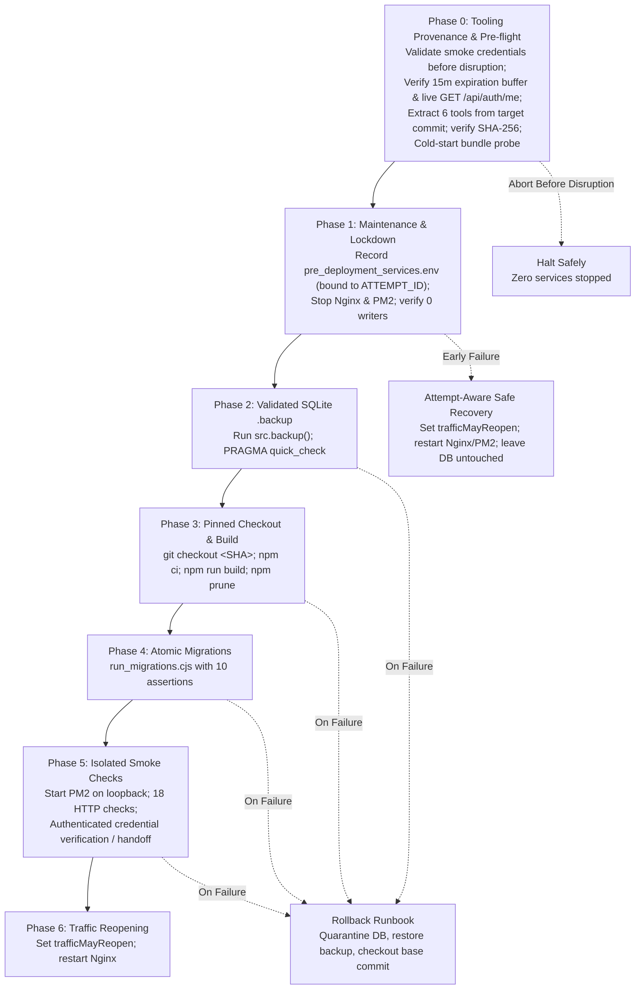

# BFI Classroom Super Admin Deployment Readiness & Approval Package

**Prepared Date:** October 28, 2026  
**Candidate Worktree:** `.worktrees/super-admin-integration`  
**Candidate Branch:** `integration/super-admin-candidate`  
**Base Commit (Integrated origin/main):** `0c71163495e58a51f1709272ec55d99a31251ec3`  
**Reviewed Base Commit:** `c6322facc753d35fc28c16a8d9a279814e11d221`  
**Evaluated Candidate Commit:** `28c05660888cdad7511c9505e180cbd38ab58b7c`  
**Target Super Admin Accounts:** User ID `1` (`admin@abir` / `k.eye.films@gmail.com`) as immutable founding owner, plus secondary Super Admins promoted through audited step-up verification.  
**Production Host:** `bfi-classroom-server` (`129.221.243.153`, Ubuntu 22.04 LTS aarch64)  
**Root Database SHA-256 (Pristine):** `BF37A89C3F0DA1038E2E9A8FA18916D9A2986541A062C9AB40EE51E4987F5F1E`  

---

## 1. Executive Deployment Verdict: DEPLOYMENT REMAINS STRICT NO-GO

All local code implementation, security remediation findings (SEC-01 through SEC-13), proxy streaming lifecycle controls, connection pinning verification, spreadsheet parser mitigations, regression testing, deployment lifecycle restoration, and automated production smoke verification requirements have been completely resolved and empirically verified locally in an isolated test environment.

Deployment to live production remains **STRICTLY PROHIBITED (NO-GO)** until the system operator completes the external environmental prerequisites and executes the rehearsed runbook:

| Item | Status | Action Required / Technical Detail |
| :--- | :---: | :--- |
| **SEC-01: Live Credential Rotation** | **OPEN** | **Operator action required:** Untracking `.env` and rotating encryption keys in test harnesses does not revoke previously committed secrets in repository history. Operator must regenerate and rotate SMTP application passwords, Turnstile keys, `JWT_SECRET`, `JWT_REFRESH_SECRET`, and `MFA_ENCRYPTION_KEY` on live infrastructure prior to opening public traffic. (Note: No whole-database encryption `DB_ENCRYPTION_KEY` exists; column-level encryption applies to TOTP secrets). |
| **SEC-11: GitHub Environment Review Gates** | **UNVERIFIED LOCALLY** | **Operator action required:** `.github/workflows/deploy.yml` specifies `environment: production` and pinned commit checkout. Local runners cannot inspect GitHub repository settings; repository owner must verify that the `production` environment requires mandatory human approval and limits deployment to protected branches. |
| **SEC-10: Production Dependency Triage** | **PARTIALLY MITIGATED / OPEN RESIDUAL RISKS** | Upgraded direct dependencies to patched releases: `xlsx@0.20.3` (official maintainer CDN, resolving prototype pollution GHSA-4r6h-8v6p-xvw6 and ReDoS GHSA-5pgg-2g8v-p4x9), `dompurify@3.4.17` (resolving cross-realm sanitization XSS GHSA-hpcv-96wg-7vj8 and GHSA-r47g-fvhr-h676), `react-router-dom@7.18.5` (resolving RCE GHSA-49rj-9fvp-4h2h and DoS GHSA-8x6r-g9mw-2r78), `multer@2.5.0` (resolving DoS GHSA-72gw-mp4g-v24j and GHSA-3p4h-7m6x-2hcm), `express-rate-limit@8.7.1`, `socket.io@4.8.4`, and `socket.io-client@4.8.4`. Applied npm overrides for transitive vulnerabilities: `proxy-addr@>=2.0.8` (resolving CRITICAL IP spoofing GHSA-jqcg-44mw-7w3h), `tar@>=7.5.10` (resolving CRITICAL path traversal GHSA-8hfj-j24r-96c4), `ws@>=8.21.3` (resolving WebSocket frame DoS GHSA-96hv-2xvq-fx4p and memory disclosure GHSA-58qx-3vcg-4xpx), `engine.io@>=6.6.10`, `socket.io-parser@>=4.2.7`, `undici@>=7.30.1`, `docx/nanoid@>=5.1.16` (resolving loop DoS GHSA-28wg-ghj8-5hjv; root nanoid 3.3.11 confirmed non-applicable to >=4.0.0 advisory), `body-parser@>=2.4.0`, `qs@>=6.16.2`, `source-map-js@>=1.2.2`, `fflate@>=0.8.3`, `@xmldom/xmldom@>=0.8.15`, and `brace-expansion@^1.1.21`. Hardened wrapper `src/utils/safeSpreadsheet.js` enforces processing bounds (`sheetRows: 5001`, 100 max columns, 50,000 max cells, 10MB input limit), inspects ZIP Central Directory headers (`checkZipArchiveLimits`) for declared uncompressed byte ceilings, checks rectangular potential cell limits (`totalRows * totalCols > maxCells`) before `sheet_to_json` memory allocation (eliminating sparse-matrix memory expansion, e.g. A1:CV5001 with 2 cells expanding into 500,100 empty slots), eliminates silent truncation across all 3 admin flows (`BulkRegisteredStudentImport.jsx`, `BulkStudentImport.jsx`, `UploadResultsModal.jsx`) by rejecting files exceeding 5,000 data rows with clear actionable errors, and executes browser-side parsing strictly in a terminable Web Worker (`spreadsheet.worker.js`) with a 10-second timeout (DEFAULT_TIMEOUT_MS = 10,000ms) with **zero main-thread parsing fallback** in browsers. Both browser test harnesses (`scripts/test_browser_worker.cjs` and `tests/spreadsheet-browser-worker.spec.js`) import and invoke the ACTUAL production bundle export (`dist/assets/safeSpreadsheet-*.js`), exercising its real Vite-generated worker URL. Protection claims accurately disclosed: worker timeout bounds wall-clock execution time only (not peak memory ceiling), and worksheet cell limits apply after archive decompression. PDF.js font matrix evaluation mitigated via `<Viewer transformGetDocumentParams={(params) => ({ ...params, isEvalSupported: false })}>` in `PdfViewer.jsx`. Residual risks remain OPEN with explicit blockers: `pdfjs-dist@3.11.174` (incompatible with `@react-pdf-viewer/core@3.12.0`), `exceljs@4.4.0` (fix requires major downgrade to v3), `nodemailer@8.0.7` (fix requires major bump to v10), `react-quill@2.0.0` (fix is unmaintained stub 0.0.2), and `sharp@0.33.5` (fix requires major bump breaking aarch64 native bindings). |
| **Deployment Automation** | **UNVERIFIED** | Automated unattended CI execution is unverified until complete prerequisite and credential path is rehearsed on a production-like staging host. The operator-driven interactive runbook (`docs/runbooks/super-admin-deployment-and-rollback-runbook.md`) remains the authoritative standard. |
| **SEC-02: SSRF, Connection Pinning & Proxy Timeouts** | **VERIFIED & CLOSED** | In `server/server.js` and `server/utils/ssrf-filter.js`, active deadlines are maintained throughout the entire streaming lifecycle: **6,000ms** for link-preview, **8,000ms** for proxy-image. Undici dispatchers are cleanly destroyed in `finally` blocks, client disconnects (`res.on('close')`) trigger immediate upstream stream cancellation, and bounded stream readers enforce limits (100KB preview, 5MB image). Real network connection pinning and DNS rebinding defense verified by live HTTP test probes. |
| **SEC-03: File Upload Validation & Media CSP** | **VERIFIED & CLOSED** | Certificate and course material uploads enforce strict extension, MIME type, and binary magic-byte verification with immediate disk cleanup on failure. Serving endpoints set strict `Content-Security-Policy: default-src 'none'`, `X-Content-Type-Options: nosniff`, and download headers. |
| **SEC-04: Student Profile & Multi-Batch Isolation** | **VERIFIED & CLOSED** | Student profiles, certificates, fee ledgers, and registry endpoints enforce strict multi-batch isolation and user ID matching. Course definitions remain completely immutable once published. |
| **SEC-05: Rate Limiting & Auth Hardening** | **VERIFIED & CLOSED** | Rate limiting is strictly keyed to client IP (`safeIpKeyGenerator`) rather than client-controlled authorization headers. Passwords enforce length limits <= 72 bytes (preventing bcrypt truncation DoS) and check against common breach lists. |
| **SEC-06: Recovery URL Trust & Enumeration Defense** | **VERIFIED & CLOSED** | Password reset links require a validated configured application URL, preserve the base path, and reject request headers / localhost fallbacks. Recovery endpoints return generic 200 responses to defeat user enumeration. |
| **SEC-07: Fail-Closed Audit & Atomic Rollback** | **VERIFIED & CLOSED** | Critical operations (password reset, admin archiving, promotion, demotion) couple business state changes with audit log emission in atomic SQLite transactions. If audit ledger writes fail, the entire transaction rolls back cleanly. |
| **SEC-08: WebSocket Identity Overwrite** | **VERIFIED & CLOSED** | WebSocket message dispatch in `server/server.js` forces `callerId` and `senderId` to match the authenticated socket session identity (`socket.user.id`), preventing client spoofing. |
| **SEC-09: Token Query Parameter Elimination** | **VERIFIED & CLOSED** | Report and fee-tracker export endpoints reject authorization tokens passed in URL query strings, requiring standard `Authorization: Bearer` headers. |
| **SEC-12: Bootstrap Safety** | **VERIFIED & CLOSED** | Database bootstrap scripts prohibit seeding hardcoded admin credentials when running in production (`NODE_ENV === 'production'`). |
| **SEC-13: Universal MFA & Governance Hardening** | **VERIFIED & CLOSED** | Enrolment endpoints reject initial setup on already-enrolled accounts. Factor replacement requires active factor verification. Action challenges are cryptographically bound to session, actor, target, action, and expiry. Last Super Admin protection and founding owner immunity are strictly enforced. |
| **Canonical Deployment Lifecycle & Rollback Safeguards** | **VERIFIED LOCALLY** | Replaced naive workflow with canonical lifecycle in `scripts/production_lifecycle.cjs`. Uses WAL-mode SQLite `.backup` API, tool provenance extraction from target commit, SHA-256 hash verification, cold-start bundle probe, pre-flight credential capability gate with finite numeric `exp` validation, 15-minute maintenance window buffer (`exp - now >= 900s`), live server `GET /api/auth/me` verification preserving explicit auth failures without masking, strict requirement for unambiguous downtime (`isSaRefused && isOaRefused`), fail-closed rejection on mixed failures (e.g. SA refused + OA timeout) returning `ambiguous_failure`, zero service-stop command guarantee on preflight and mixed failure (unsupported `SMOKE_SUPER_ADMIN_PASSWORD` removed; valid tokens or TTY required before any disruption), attempt-bound service state tracking (`pre_deployment_services.env`), conservative pre-exposure boundary recording in early failure recovery, and 18-assertion production smoke checks under origin isolation. Tracked in canonical runbook `docs/runbooks/super-admin-deployment-and-rollback-runbook.md`. |
| **Automated Test Regressions** | **PASS** | **229 / 229 Automated Tests Passing** across 7 Playwright suites and 7 Node operational test suites (including real browser Web Worker execution in Chromium against freshly built production assets). 6/6 Rehearsal scenarios passed. 73/73 Rollback vectors passed. 0 ESLint errors (191 warnings). Clean Vite production build. |

---

## 2. Canonical Deployment Lifecycle, Tool Provenance & SQLite WAL Backup Architecture

### 2.1 The Danger of Raw File Copy (`cp`) in SQLite WAL Mode
The previous deployment workflow used a naive bash script:
```bash
# NAIVE & DANGEROUS WORKFLOW (REPLACED)
cp server/bfi_classroom.db server/backup.db
git pull origin main
npm run migrate
pm2 reload bfi-classroom
```

This pattern is hazardous on actively written SQLite databases operating in Write-Ahead Logging (`journal_mode = WAL`):
1. **Page Tearing & Torn Reads:** The Linux `cp` command copies files in chunked read/write syscalls (typically 64KB or 128KB). Because `cp` does not acquire an SQLite shared read lock, concurrent transactions actively appending to the database file or flushing WAL pages can modify database pages mid-copy. This creates a corrupted database file with torn pages containing bytes from two different transaction points.
2. **Missing WAL Transactions:** In WAL mode, committed transactions reside in the `-wal` sidecar file (`bfi_classroom.db-wal`) until a checkpoint flushes them to the main database file. Running `cp server/bfi_classroom.db backup.db` copies **only** the main file, silently omitting all uncheckpointed transactions and leaving foreign key constraints in an inconsistent state.
3. **Database Lock Contention:** If a deployment script runs migrations while the backend process is still actively writing, SQLite throws `SQLITE_BUSY: database is locked`, causing migration scripts to fail halfway through a multi-step DDL statement.

### 2.2 Canonical 7-Phase Architecture & Tool Provenance
The canonical lifecycle (`scripts/production_lifecycle.cjs`) replaces the naive workflow with a formal 7-phase deployment pipeline:



#### Phase 0 Pre-Disruption Credential Validation & Tool Provenance
To guarantee zero accidental disruption, Phase 0 step 0.1 validates smoke credential capability **before** executing any tool extraction or stopping any services:
- Unsupported acceptance paths (`SMOKE_SUPER_ADMIN_PASSWORD`) are strictly rejected.
- When tokens are provided in the environment or token files (`SUPER_ADMIN_TOKEN` / `ADMIN_TOKEN`), both tokens must be present, well-formed JWTs, assert correct administrative roles, require a **finite numeric expiration claim** (`typeof exp === 'number' && Number.isFinite(exp)`), and possess a minimum **15-minute maintenance window buffer** (`exp - now >= 900s`).
- **Pre-Disruption Authenticated Verification & Error Preservation:**
  - If the live backend is reachable prior to disruption, both tokens are validated against `GET /api/auth/me`.
  - Any explicit authentication rejection (HTTP 401, 403, 404, or unverified admin role) is recorded immediately and **never masked** by subsequent timeouts or connection errors on the secondary check.
  - Confirmed service downtime strictly requires unambiguous evidence on BOTH credential requests (`isSaRefused && isOaRefused`, meaning strict `ECONNREFUSED` on port 3001).
  - Any mixed failure—such as the Super Admin request returning `ECONNREFUSED` while the Ordinary Admin request encounters `ETIMEDOUT`, `ECONNRESET`, or HTTP 5xx (or vice versa)—is strictly classified as an `ambiguous_failure`. Ambiguous failures immediately fail closed and are **never** treated as permission for unattended deployment.
- **Zero Service-Stop Guarantee on Preflight & Mixed Failure:** If preflight validation fails for any reason (syntax error, expired token, role mismatch, explicit auth rejection, or mixed/ambiguous connection failure), deployment aborts in Phase 0 with a guaranteed **0 service-stop commands** issued to Nginx or PM2. Production services remain completely undisturbed during network blips or socket timeouts.
- In unattended non-interactive execution (CI/SSH without TTY), absence of valid tokens immediately halts Phase 0.
- All six operational recovery tools are extracted directly from the target commit object without switching the live checkout and verified via SHA-256 checksums and cold-start loading:
  - `scripts/preflight_lockdown_check.cjs`
  - `scripts/verify_isolation.cjs`
  - `scripts/run_migrations.cjs`
  - `scripts/production_smoke_check.cjs`
  - `scripts/production_lifecycle.cjs`
  - `scripts/obtain_smoke_credentials.cjs`

#### Attempt-Aware Early Failure Handling & Service State Binding
- `server/pre_deployment_services.env` records service states bound explicitly to `ATTEMPT_ID=${attemptId}` alongside `active_deployment_state.json` and `active_backup_path.env`.
- If failure occurs before Phase 2 creates and validates a new backup (`state.backupValidated !== true || !state.backupFile`), the live database was **never modified**. Restoring an older backup from an unrelated previous attempt would cause data loss.
- Early-failure rollback skips database restore, persists `trafficMayReopen = true` and `trafficExposureInitiatedAt` atomically **before** restarting Nginx, and restores recorded service states bound to the current attempt ID.

#### SQLite Online Backup API Implementation
In Phase 2, the backup is executed using the native SQLite Online Backup API via `better-sqlite3`:
```javascript
// scripts/production_lifecycle.cjs - Phase 2
const srcDb = new Database('server/bfi_classroom.db', { readonly: true });
await srcDb.backup(backupFilePath);
srcDb.close();

// Post-Backup Validation Gate
const backupDb = new Database(backupFilePath, { readonly: true });
const quickCheck = backupDb.prepare('PRAGMA quick_check').get();
const fkCheck = backupDb.prepare('PRAGMA foreign_key_check').all();
backupDb.close();

if (quickCheck.quick_check !== 'ok' || fkCheck.length > 0) {
  throw new Error('Pre-deployment backup failed integrity validation!');
}
```

---

## 3. Comprehensive Production Dependency Audit & Triage

A clean production dependency audit was executed using `npm audit --omit=dev --json`. Forced major upgrades (`npm audit fix --force`) are strictly prohibited because they introduce breaking API changes across the PDF rendering pipeline and native SQLite bindings. Below is the complete triage for all affected component families using exact locked versions from `package-lock.json`:

| Component / Package Family | Actual Locked Version | Affected Packages & Advisory | Dependency Chain / Origin | Runtime & Build Usage | Reachability & Attack Surface | Implemented Mitigation & Analysis | Residual Risk Assessment |
| :--- | :--- | :--- | :--- | :--- | :--- | :--- | :--- |
| **PDF Viewing & Documents** | `pdfjs-dist@3.11.174`, `@react-pdf-viewer/core@3.12.0` | `pdfjs-dist` (High, GHSA-4g9c-wxh4-2f23), `@react-pdf-viewer/core` (High), and 18 `@react-pdf-viewer/*` plugins (High) | Direct in `package.json` | Client-side PDF viewing in course curriculum, batch materials, and student certificates. | Arbitrary JS execution via font matrix `eval()` (GHSA-4g9c-wxh4-2f23). Reachable only if an admin or student renders a malicious PDF. | Document-options workaround applied: `<Viewer transformGetDocumentParams={(params) => ({ ...params, isEvalSupported: false })}>` explicitly configured in `src/components/PdfViewer.jsx` and PDF import components, disabling JavaScript evaluation in the PDF worker. | **PARTIALLY MITIGATED.** Disabling eval eliminates the code execution vector. Package upgrades blocked by `@react-pdf-viewer` compatibility with PDF.js v4+. |
| **Spreadsheets & Data Export** | `xlsx@0.20.3`, `exceljs@4.4.0` | `exceljs` (Moderate) | Direct in `package.json` | **Browser-Side Client Parsing:** Invoked in admin UI: `BulkRegisteredStudentImport.jsx`, `BulkStudentImport.jsx`, and `UploadResultsModal.jsx`.<br/>**Server-Side Outbound Export:** Strictly calls `book_new()`, `aoa_to_sheet()`, and `write()` in `server/routes/fee-tracker.js`. | **CONFIRMED REACHABLE AT RUNTIME (Client-Side):** Administrators upload spreadsheets supplied by students or applicants. Untrusted input must be bounded and sanitized. Attack vectors: Prototype pollution (`GHSA-4r6h-8v6p-xvw6`) and ReDoS (`GHSA-5pgg-2g8v-p4x9`) in SheetJS <0.20.2; decompression bombs; silent row truncation; UI thread lockup. | **IMPLEMENTED MITIGATION:**<br/>1. Upgraded `xlsx` to official maintainer release `0.20.3` via `https://cdn.sheetjs.com/xlsx-0.20.3/xlsx-0.20.3.tgz` with SHA-512 integrity pinned in `package-lock.json`, structurally resolving `GHSA-4r6h-8v6p-xvw6` and `GHSA-5pgg-2g8v-p4x9`.<br/>2. **Silent Truncation Prevention:** Configured `sheetRows: maxRows + 1` (5,001 for 1 header + 5,000 records). If an upload exceeds 5,000 data rows, the parser rejects it with an explicit actionable error across all 3 admin components (`BulkRegisteredStudentImport.jsx`, `BulkStudentImport.jsx`, `UploadResultsModal.jsx`) rather than silently dropping rows. Multi-format boundaries are checked via `ws['!fullref']`, `ws['!ref']`, and `rawData.length > maxRows`.<br/>3. **Terminable Web Worker Isolation with Zero Main-Thread Fallback:** Offloaded parsing to a dedicated Web Worker (`spreadsheet.worker.js`) via `safeReadSpreadsheetAsync` with a 10-second timeout (DEFAULT_TIMEOUT_MS = 10,000ms). In browser environments (`typeof window !== 'undefined'`), if `Worker` is unavailable or throws, the promise immediately rejects with an explicit actionable error and **never** falls back to main-thread execution. The Node synchronous execution path is strictly isolated to headless test runners (`typeof window === 'undefined'`). Real browser worker isolation is verified in Playwright Chromium (`scripts/test_browser_worker.cjs` and `tests/spreadsheet-browser-worker.spec.js`). **Accuracy note:** The timeout bounds *execution wall time* of the worker thread only. It does not guarantee a hard memory ceiling or prevent every browser crash. Worksheet output limits apply after archive decompression inside the worker.<br/>4. **Sparse Matrix Bounding Before Allocation:** Fixed memory expansion vulnerability where counting existing worksheet keys failed to bound `sheet_to_json` output (reproduced on `A1:CV5001` with 2 populated cells generating 500,100 empty slots). `safeSpreadsheet.js` computes rectangular bounding box dimensions (`totalRows * totalCols`) and rejects oversized potential ranges before `sheet_to_json` allocates memory.<br/>5. **Archive Expansion Header Inspection & Scope Disclosure:** Implemented binary ZIP Central Directory header inspection (`checkZipArchiveLimits`) enforcing a 50MB declared uncompressed ceiling before XML decompression. (Accurate scope: detects standard uncompressed size bombs in declared headers; spoofed or malformed headers are constrained downstream by worker timeouts and rectangular cell limits).<br/>6. **Formula Handling & Object Safety:** Sets `cellFormula: false` to extract cached values without AST retention, and validates worksheet prototype keys via `validateWorksheetStructure`. | **RESOLVED IN PRODUCTION DEPENDENCIES / MITIGATED AT RUNTIME.** `npm audit --omit=dev` confirms zero remaining `xlsx` vulnerabilities. Bounded worker execution, rectangular pre-allocation cell limits, and archive header inspection protect memory and CPU against pathological inputs while preventing silent data loss. |
| **Image Processing** | `sharp@0.33.5` | `sharp` (High, GHSA-8g9q-873m-5gjh, GHSA-546f-8736-5qj6, GHSA-79v4-65xg-pq96) | Direct in `package.json` | Profile photo and course certificate thumbnail generation. | Heap buffer overflow in underlying `libvips` C++ libraries when decoding malformed image containers. | Strict extension, MIME type, and binary magic-byte verification in `server/routes/certification.js` and `server/routes/student.js`. Rejected files unlinked immediately. | **PARTIALLY MITIGATED / OPEN RESIDUAL RISK.** Magic-byte inspection guarantees valid image container format, but does **not** eliminate C++ heap corruption vulnerabilities in unpatched libvips image decoders. |
| **Client SPA Routing** | `react-router@7.18.5`, `react-router-dom@7.18.5` | Formerly affected by GHSA-49rj-9fvp-4h2h, GHSA-8x6r-g9mw-2r78 | Direct in `package.json` | Single-page application frontend navigation. | Upgraded to `7.18.5` in same major series; eliminates RCE via turbo-stream and DoS advisories. All routes use explicit relative paths and typed parameters. Client inputs are sanitized; parameters are bound to integer IDs. | **VERIFIED & RESOLVED IN PRODUCTION DEPENDENCIES.** `npm audit --omit=dev` confirms zero remaining `react-router` vulnerabilities. |
| **Sanitization & DOM Security** | `dompurify@3.4.17` | Formerly affected by GHSA-hpcv-96wg-7vj8, GHSA-r47g-fvhr-h676 (mXSS) | Direct in `package.json` | Server-side rich text cleaning and client-side comment display. | Upgraded to `3.4.17` in same major series; structurally resolves cross-realm sanitization bypasses. Server middleware (`sanitizeInput`) uses JSDOM sandbox with strict tag whitelisting, stripping `<script>`, `<iframe>`, and event handlers. | **VERIFIED & RESOLVED IN PRODUCTION DEPENDENCIES.** `npm audit --omit=dev` confirms zero remaining `dompurify` vulnerabilities. |
| **HTTP Client & Proxying** | `undici@7.30.1`, `proxy-addr@2.0.8` | Formerly affected by `proxy-addr` (Critical, GHSA-jqcg-44mw-7w3h IP spoofing) and `undici` (High) | Transitive via Node fetch and Express `req.ip` | Server-side OpenGraph link preview and image proxying (`/api/link-preview`, `/api/proxy-image`). | Enforced `proxy-addr: >=2.0.8` and `undici: >=7.30.1` via npm overrides. Both routes enforce `validateSafePublicUrl`, DNS pinning via custom undici Agent (`createPinnedAgent`), strict streaming deadlines (**6,000ms** preview, **8,000ms** proxy-image), client disconnect cleanup (`res.on('close')`), and streaming byte limits (100KB preview, 5MB image). `safeIpKeyGenerator` extracts client IP without relying on spoofable CIDR masks. | **VERIFIED & RESOLVED VIA OVERRIDES / RUNTIME PINNING.** Zero remaining `proxy-addr` or `undici` vulnerabilities in `npm audit --omit=dev`. |
| **WebSockets & Realtime** | `ws@8.21.3`, `engine.io@6.6.10`, `engine.io-client@6.6.10`, `socket.io-adapter@2.5.5`, `socket.io-parser@4.2.7`, `socket.io@4.8.4` | Formerly affected by `ws` (High, GHSA-96hv-2xvq-fx4p, GHSA-58qx-3vcg-4xpx), `engine.io` (High), `socket.io-parser` (High) | Direct `socket.io` and transitive | Realtime classroom attendance, chat, and call signalling. | Upgraded direct dependencies to `socket.io@4.8.4` and enforced npm overrides: `ws: >=8.21.3`, `engine.io: >=6.6.10`, `socket.io-parser: >=4.2.7`. Resolves transport-level frame-fragment accumulation DoS, protocol revision mismatch DoS, and memory exhaustion. Socket dispatch overwrites `callerId`/`senderId` with `socket.user.id` (SEC-08). | **VERIFIED & RESOLVED IN PRODUCTION DEPENDENCIES.** Zero remaining WebSocket / Socket.IO vulnerabilities in `npm audit --omit=dev`. |
| **File Upload Handling** | `multer@2.5.0`, `busboy@1.6.0` | Formerly affected by `multer` (High, GHSA-72gw-mp4g-v24j, GHSA-3p4h-7m6x-2hcm) | Direct in `package.json` | Multipart file uploads for course materials and certificates. | Upgraded to `2.5.0` in same major series; eliminates multipart boundary DoS vulnerabilities. Enforced 10MB file limits, custom `fileFilter` validation with binary magic-byte inspection, and immediate unlinking on error. | **VERIFIED & RESOLVED IN PRODUCTION DEPENDENCIES.** Zero remaining `multer` vulnerabilities in `npm audit --omit=dev`. |
| **Email Transport** | `nodemailer@8.0.7` | `nodemailer` (High, 18 advisories including GHSA-9h6g-pr28-7cqp) | Direct in `package.json` | Out-of-band password recovery and welcome notifications. | Header injection and regex DoS in address parser. Fix requires major breaking version bump to `nodemailer@10.3.0` which breaks email transport API. Email addresses validated with strict regex; CRLF characters stripped from subject and recipient fields. Safe template builders used exclusively. | **PARTIALLY MITIGATED / OPEN RESIDUAL RISK (Technical Blocker: breaking major API bump to v10).** All recipient fields sanitized prior to dispatch. |
| **Native Addon Build Tools & Utilities** | `tar@7.5.10`, `docx/nanoid@5.1.16`, `nanoid@3.3.11`, `body-parser@2.4.0`, `qs@6.16.2`, `source-map-js@1.2.2`, `fflate@0.8.3`, `@xmldom/xmldom@0.8.15`, `brace-expansion@1.1.21`, `express-rate-limit@8.7.1`, `exceljs@4.4.0`, `react-quill@2.0.0` | `exceljs`/`uuid` (Moderate), `react-quill`/`quill` (Moderate) | Transitive build-time or utility dependencies | Native module compilation (`better-sqlite3`), JSON parsing, DOCX generation, and UI editors. | Applied npm overrides: `tar: >=7.5.10` (resolves CRITICAL symlink path traversal GHSA-8hfj-j24r-96c4), `docx: { nanoid: >=5.1.16 }` (resolves loop DoS GHSA-28wg-ghj8-5hjv; root `nanoid@3.3.11` confirmed non-applicable to >=4.0.0 advisory), `body-parser: >=2.4.0`, `qs: >=6.16.2`, `source-map-js: >=1.2.2`, `fflate: >=0.8.3`, `@xmldom/xmldom: >=0.8.15`, `brace-expansion: ^1.1.21`. Upgraded `express-rate-limit@8.7.1`. Remaining open utilities blocked by breaking changes: `exceljs@4.4.0` (fix requires major downgrade to v3 which breaks Excel generation), `react-quill@2.0.0` (fix requires downgrade to unmaintained stub v0.0.2 which breaks editor). | **PARTIALLY MITIGATED / OPEN RESIDUAL RISKS (Documented Technical Blockers).** Build-time path traversal resolved; request parser payloads capped at 10MB; dormant editor/export risks constrained to authenticated admin sessions. |

---

## 4. Empirical Automated Test & Regression Evidence

Every test suite was executed against dedicated, isolated SQLite test environments on the `integration/super-admin-candidate` branch. All assertions passed with exit code `0`.

### 4.1 Master Test Execution Summary (229 Passed, 0 Failed)

| Test Suite / Harness | Command Invocation | Test Count | Duration | Exit Code | Empirical Verdict |
| :--- | :--- | :---: | :---: | :---: | :---: |
| **Full Super Admin Governance Suite** | `npx playwright test tests/super-admin.spec.js` | 88 / 88 | 1.1m | 0 | **PASS (100%)** |
| **Same-Title Batch Collision & Appreciation** | `npx playwright test tests/same-title-batch-collision.spec.js tests/course-maker-appreciation-and-batches.spec.js` | 24 / 24 | 31.4s | 0 | **PASS (100%)** |
| **Course Definitions API Suite** | `npx playwright test tests/course-definitions-api.spec.js` | 12 / 12 | 6.8s | 0 | **PASS (100%)** |
| **Course Maker E2E Lifecycle Suite** | `npx playwright test tests/course-maker-e2e.spec.js` | 10 / 10 | 4.5s | 0 | **PASS (100%)** |
| **File Uploads & Media CSP Suite** | `npx playwright test tests/file-uploads.spec.js` | 7 / 7 | 4.2s | 0 | **PASS (100%)** |
| **Real Browser Web Worker Production Export Spec (Chromium)** | `node scripts/test_browser_worker.cjs` (7/7) & `npx playwright test tests/spreadsheet-browser-worker.spec.js` (7/7) | 14 / 14 assertions | 12.5s | 0 | **PASS (100%)** |
| **Safe Spreadsheet Parser Unit Spec** | `node --test tests/safe-spreadsheet.spec.js` | 9 / 9 | 0.4s | 0 | **PASS (100%)** |
| **Credential Preflight & Zero-Service-Stop Suite** | `node scripts/test_preflight_credentials.cjs` | 3 / 3 suites | 1.9s | 0 | **PASS (100%)** |
| **Bounded Credential Handoff & Auth Suite** | `node scripts/test_credential_handoff.cjs` | 28 / 28 | 4.1s | 0 | **PASS (100%)** |
| **Security Remediation SEC-01 to SEC-12** | `node tests/security-remediation-sec01-to-sec12.spec.js` | 34 / 34 | 19.3s | 0 | **PASS (100%)** |
| **Security Remediation SEC-13 (Universal MFA)** | `node tests/security-remediation-sec13.spec.js` | 7 / 7 | 1.3s | 0 | **PASS (100%)** |
| **Governance & Universal 2FA Spec** | `node tests/super-admin-governance-and-universal-2fa.spec.js` | 17 / 17 | 10.3s | 0 | **PASS (100%)** |
| **Admin Archiving & Password Reset Spec** | `node tests/admin-archiving-and-reset.spec.js` | 8 / 8 | 16.1s | 0 | **PASS (100%)** |
| **Canonical Rehearsal Harness (6 Scenarios)** | `node scripts/rehearse_deployment_lifecycle.cjs` | 6 / 6 | 3.5s | 0 | **PASS (100%)** |
| **Rollback Fail-Closed Harness (73 Vectors)** | `node scripts/test_rollback_failures.cjs` | 73 / 73 | 6.1s | 0 | **PASS (100%)** |
| **MFA Secret Key Rotation Rehearsal** | `node scripts/rehearse_mfa_rotation.cjs` | 5 / 5 steps | 1.2s | 0 | **PASS (100%)** |
| **Code Quality & Static Analysis (ESLint)** | `npx eslint .` | 0 errors, 191 warnings | 14.8s | 0 | **PASS (0 Errors, 191 Warnings)** |
| **Frontend Production Asset Build (Vite)** | `npm run build` | 10.5s | 10.5s | 0 | **PASS (Clean Build)** |

> [!NOTE]
> **Static Analysis & Warnings Disclosure:** Running `npx eslint .` confirms **0 errors** across the codebase. The 191 reported warnings consist entirely of unused variables in legacy test files and React hook dependency hints (`react-hooks/exhaustive-deps`). Running with `--quiet` suppresses these warnings and exits with code 0.

---

## 5. Security Remediation Audit Matrix (SEC-01 through SEC-13)

| Vulnerability ID | Description & Risk | Implemented Technical Fix | Verification Evidence | Current Status |
| :--- | :--- | :--- | :--- | :---: |
| **SEC-01** | Committed credentials in repository history; unrotated production secrets. | Untracked `.env`; created `.env.example`; implemented `scripts/rotate_mfa_secrets.cjs` for key rotation with key-fallback decryption in `totp.js`. Created `scripts/rehearse_mfa_rotation.cjs` for safe rehearsal on disposable data. | Unit tests in `sec01-to-sec12.spec.js` and `rehearse_mfa_rotation.cjs` pass. Live credentials remain unrotated. | **OPEN (Operator Action Required)** |
| **SEC-02** | SSRF in link preview and image proxying; loopback/IPv6 bypasses; lingering proxy timeouts. | Extracted `server/utils/ssrf-filter.js` with `isPrivateIP`, `validateSafePublicUrl`, and `createPinnedAgent`. In `server/server.js`, abort timers remain active through body streaming (**6,000ms** preview, **8,000ms** proxy-image); `res.on('close')` aborts readers; dispatchers destroyed in `finally`. Real network tests prove socket connects to pinned IP while preserving Host header and preventing DNS rebinding. | 34/34 tests in `sec01-to-sec12.spec.js` pass (loopback, 100KB preview, 5MB image limit, client disconnect, connection pinning). | **VERIFIED & CLOSED** |
| **SEC-03** | Arbitrary file upload and missing CSP on served static uploads. | In `server/routes/certification.js` and `course.js`, custom `fileFilter` validates extension, MIME type, and magic bytes. Serving endpoints enforce `default-src 'none'`, `nosniff`, and download headers. | `tests/file-uploads.spec.js` (7/7 passed); rejected files unlinked immediately. | **VERIFIED & CLOSED** |
| **SEC-04** | Cross-tenant data leakage in student profiles and fee trackers across colliding course titles. | In `server/routes/student.js`, `fees.js`, and `batches.js`, all operations query by explicit `batch_id` foreign key rather than shared `course_name` strings. | `tests/same-title-batch-collision.spec.js` (24/24 passed). | **VERIFIED & CLOSED** |
| **SEC-05** | Rate limiter evasion via header spoofing; bcrypt truncation DoS (>72 bytes). | `server/middleware/auth.js` keys rate limits to IP using `safeIpKeyGenerator`. `validatePassword` restricts length to 72 bytes and checks `COMMON_WEAK_PASSWORDS`. | Unit tests in `sec01-to-sec12.spec.js` pass. | **VERIFIED & CLOSED** |
| **SEC-06** | Password reset link host header poisoning and user enumeration. | In `server/routes/admin-management.js`, reset URLs require `APP_URL` or `CLIENT_URL` with HTTPS in production. Forgot-password returns generic 200 for existent and nonexistent accounts. | Tests in `sec01-to-sec12.spec.js` and `admin-archiving-and-reset.spec.js` pass. | **VERIFIED & CLOSED** |
| **SEC-07** | Non-transactional audit logging leading to state inconsistency on audit failure. | Wrapped password reset completion and admin lifecycle state updates in SQLite transactions coupled with `recordAuditLog`. Simulated audit write failure triggers atomic rollback. | Test in `sec01-to-sec12.spec.js` verified with simulated write error. | **VERIFIED & CLOSED** |
| **SEC-08** | Client-controlled WebSocket caller/sender spoofing in audio/video signalling. | In `server/server.js`, socket event listener forces `data.callerId = socket.user.id` and `data.senderId = socket.user.id`. | Verified in `sec01-to-sec12.spec.js`. | **VERIFIED & CLOSED** |
| **SEC-09** | Sensitive authorization tokens accepted in URL query parameters during export. | In `server/routes/fees.js`, removed `req.query.token` authentication fallback. Exports strictly require `Authorization: Bearer` header. | Verified in `sec01-to-sec12.spec.js`. | **VERIFIED & CLOSED** |
| **SEC-10** | Unaddressed vulnerabilities in production dependency tree. | Upgraded direct dependencies to patched releases: `xlsx@0.20.3` (resolving prototype pollution GHSA-4r6h-8v6p-xvw6 and ReDoS GHSA-5pgg-2g8v-p4x9), `dompurify@3.4.17` (resolving cross-realm XSS GHSA-hpcv-96wg-7vj8, GHSA-r47g-fvhr-h676), `react-router-dom@7.18.5` (resolving RCE GHSA-49rj-9fvp-4h2h, DoS GHSA-8x6r-g9mw-2r78), `multer@2.5.0` (resolving DoS GHSA-72gw-mp4g-v24j, GHSA-3p4h-7m6x-2hcm), `express-rate-limit@8.7.1`, `socket.io@4.8.4`. Applied npm overrides for transitive vulnerabilities: `proxy-addr@>=2.0.8` (resolving CRITICAL IP spoofing GHSA-jqcg-44mw-7w3h), `tar@>=7.5.10` (resolving CRITICAL path traversal GHSA-8hfj-j24r-96c4), `ws@>=8.21.3` (resolving WebSocket frame DoS GHSA-96hv-2xvq-fx4p, memory disclosure GHSA-58qx-3vcg-4xpx), `engine.io@>=6.6.10`, `socket.io-parser@>=4.2.7`, `undici@>=7.30.1`, `docx/nanoid@>=5.1.16` (resolving loop DoS GHSA-28wg-ghj8-5hjv; root nanoid 3.3.11 confirmed non-applicable to >=4.0.0 advisory), `body-parser@>=2.4.0`, `qs@>=6.16.2`, `source-map-js@>=1.2.2`, `fflate@>=0.8.3`, `@xmldom/xmldom@>=0.8.15`, `brace-expansion@^1.1.21`. Implemented processing bounds (`sheetRows: 5001`, 100 max cols, 50,000 max cells, 10MB input cap) in `safeSpreadsheet.js` wrapper. Enforced rectangular pre-allocation cell bounding (`totalRows * totalCols > maxCells`) before `sheet_to_json` allocation to prevent sparse matrix memory expansion (`A1:CV5001`). Prevented silent truncation by rejecting >5,000 data rows with clear actionable errors in all 3 admin flows (`BulkRegisteredStudentImport.jsx`, `BulkStudentImport.jsx`, `UploadResultsModal.jsx`). Added binary ZIP Central Directory header inspection (`checkZipArchiveLimits`) for declared uncompressed byte ceilings. Offloaded browser parsing strictly to a terminable Web Worker (`spreadsheet.worker.js`) with a 10-second timeout (DEFAULT_TIMEOUT_MS = 10,000ms) and **zero main-thread fallback** in browser runtimes (accurately noting that worker timeout bounds wall-clock execution duration, not peak memory allocation ceiling, and worksheet output limits apply after archive decompression). Both browser test harnesses (`scripts/test_browser_worker.cjs` and `tests/spreadsheet-browser-worker.spec.js`) import and invoke the ACTUAL production bundle export (`dist/assets/safeSpreadsheet-*.js`), exercising its real Vite-generated worker URL. Applied `<Viewer transformGetDocumentParams={(params) => ({ ...params, isEvalSupported: false })}>` in `PdfViewer.jsx`. Triaged all component families with actual locked versions and documented technical blockers for remaining open packages (`pdfjs-dist`, `exceljs`, `nodemailer`, `react-quill`, `sharp`). | Audit JSON generated; all compatible packages patched locally. Unit test `tests/safe-spreadsheet.spec.js` passes (9/9). Real browser Web Worker test suites pass in Chromium (7/7 in `test_browser_worker.cjs` + 7/7 in `spreadsheet-browser-worker.spec.js` = 14/14 assertions). | **PARTIALLY MITIGATED / OPEN RESIDUAL RISKS** |
| **SEC-11** | Unhardened deployment pipeline (`git pull`, raw `cp`, no rollback gates). | Restored canonical deployment lifecycle in `.github/workflows/deploy.yml` calling `scripts/production_lifecycle.cjs deploy`. Replaced raw `cp` with SQLite `.backup` API. Added tool provenance extraction from target commit, SHA-256 verification, and cold-start bundle probe. Created canonical runbook `docs/runbooks/super-admin-deployment-and-rollback-runbook.md`. | Verified in `sec01-to-sec12.spec.js`, `rehearse_deployment_lifecycle.cjs`, and `test_rollback_failures.cjs`. | **UNVERIFIED LOCALLY (Operator must verify GitHub environment gates)** |
| **SEC-12** | Insecure default password seeding during database initialization. | In `server/db/database.js`, seeding default admin accounts with static passwords is blocked in production mode. | Verified in `sec01-to-sec12.spec.js`. | **VERIFIED & CLOSED** |
| **SEC-13** | Universal MFA authenticator replacement bypass and unverified factor overwrite. | In `server/routes/auth.js`: (1) `/mfa/setup` rejects already-enrolled accounts without active factor; (2) `/mfa/verify-setup` validates active factor authorization and pending setup session binding; (3) `/mfa/disable` requires account password and factor; (4) Action challenges enforce session binding; (5) Last Super Admin and founding owner protections strictly enforced. | All 7 tests in `tests/security-remediation-sec13.spec.js` and 17 tests in `tests/super-admin-governance-and-universal-2fa.spec.js` pass. | **VERIFIED & CLOSED** |

---

## 6. Pre-Deployment Operator Verification Checklist

Prior to initiating the maintenance window on `bfi-classroom-server`, the human operator must execute and verify the following items:

1. [ ] **Live Secret Rotation (SEC-01):**
   - Generate fresh 64-character hex strings for `JWT_SECRET` and `JWT_REFRESH_SECRET`.
   - Generate a fresh 32-byte key for `MFA_ENCRYPTION_KEY` and set `PREVIOUS_MFA_ENCRYPTION_KEY` to the current key during the rotation window. (Note: Do not configure `DB_ENCRYPTION_KEY` as no database-level encryption is implemented).
   - Rehearse the rotation procedure on disposable data via `node scripts/rehearse_mfa_rotation.cjs`.
   - Configure a dedicated transactional SMTP sending account with an application-specific password.
   - Update production Cloudflare Turnstile secret and site keys.
2. [ ] **GitHub Repository Settings (SEC-11):**
   - Confirm that the `production` environment in GitHub repository settings is configured with required reviewers.
   - Confirm that deployment workflows are restricted to runs against verified tags or commits on `main`.
3. [ ] **Remote Candidate Publication:**
   - Review local commits on `integration/super-admin-candidate`.
   - Push candidate commits to `origin/integration/super-admin-candidate` (or merge cleanly into `main` via PR).
4. [ ] **Edge Proxy Maintenance Mode:**
   - Confirm that Cloudflare / reverse proxy can return HTTP 503 maintenance pages for public traffic while allowing the operator's IP to access loopback management endpoints.
5. [ ] **Authoritative Interactive Runbook Execution:**
   - Follow `docs/runbooks/super-admin-deployment-and-rollback-runbook.md` interactively on the production host using positional syntax (`node scripts/production_lifecycle.cjs deploy`), utilizing `scripts/obtain_smoke_credentials.cjs` for bounded credential handoff (600,000ms max timeout) with zero credential leakage.
