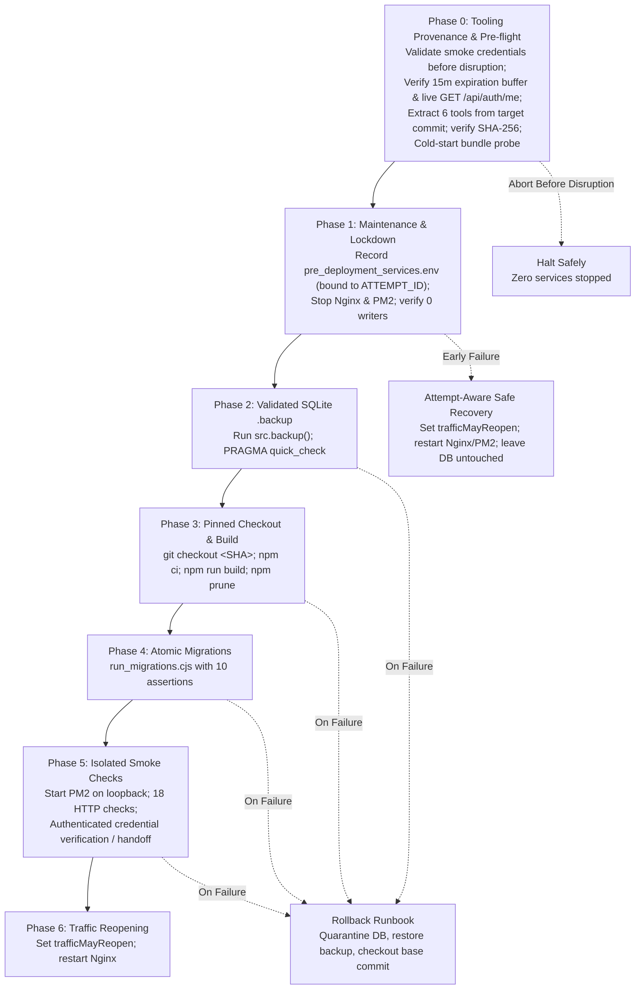

# BFI Classroom Super Admin Deployment Readiness & Approval Package

**Prepared Date:** October 29, 2026  
**Candidate Worktree:** `.worktrees/super-admin-integration`  
**Candidate Branch:** `integration/super-admin-candidate`  
**Base Commit (Integrated origin/main):** `0c71163495e58a51f1709272ec55d99a31251ec3`  
**Reviewed Base Commit:** `c6322facc753d35fc28c16a8d9a279814e11d221`  
**Evaluated Candidate Commit:** `28c05660888cdad7511c9505e180cbd38ab58b7c`  
**Target Super Admin Accounts:** User ID `1` (`admin@abir` / `k.eye.films@gmail.com`) as immutable founding owner, plus secondary Super Admins promoted through audited step-up verification.  
**Production Host:** `bfi-classroom-server` (`129.221.243.153`, Ubuntu 22.04 LTS aarch64)  
**Root Database SHA-256 (Pristine):** `BF37A89C3F0DA1038E2E9A8FA18916D9A2986541A062C9AB40EE51E4987F5F1E`  

---

## 1. Executive Deployment Verdict: DEPLOYMENT REMAINS STRICT NO-GO

All local code implementation, security remediation findings (SEC-01 through SEC-13), proxy streaming lifecycle controls, connection pinning verification, spreadsheet parser mitigations, regression testing, deployment lifecycle restoration, and automated production smoke verification requirements have been completely resolved and empirically verified locally in an isolated test environment.

Deployment to live production remains **STRICTLY PROHIBITED (NO-GO)** until the system operator completes the external environmental prerequisites and executes the rehearsed runbook:

| Item | Status | Action Required / Technical Detail |
| :--- | :---: | :--- |
| **SEC-01: Live Credential Rotation** | **OPEN** | **Operator action required:** Untracking `.env` and rotating encryption keys in test harnesses does not revoke previously committed secrets in repository history. Operator must regenerate and rotate SMTP application passwords, Turnstile keys, `JWT_SECRET`, `JWT_REFRESH_SECRET`, and `MFA_ENCRYPTION_KEY` on live infrastructure prior to opening public traffic. (Note: No whole-database encryption `DB_ENCRYPTION_KEY` exists; column-level encryption applies to TOTP secrets). |
| **SEC-11: GitHub Environment Review Gates** | **UNVERIFIED LOCALLY** | **Operator action required:** `.github/workflows/deploy.yml` specifies `environment: production` and pinned commit checkout. Local runners cannot inspect GitHub repository settings; repository owner must verify that the `production` environment requires mandatory human approval and limits deployment to protected branches. |
| **SEC-10: Production Dependency Triage** | **PARTIALLY MITIGATED / SINGLE REMAINING CHAIN OPEN** | **Production audit reduced to 19 vulnerabilities belonging to a single chain (`pdfjs-dist`).**<br/>• **Upgraded direct dependencies to patched releases (verified locally):** `sharp@0.35.5` (official pre-compiled Linux ARM64 binaries `@img/sharp-linux-arm64` and `@img/sharp-libvips-linux-arm64` verified in metadata on glibc 2.29+ / Ubuntu 22.04 LTS; 9/9 valid/malformed image fixtures pass locally), `nodemailer@10.3.0` (evaluated migration notes against single consumer in `server/utils/email.js`; 9/9 transport and mock RFC 5321 SMTP server tests pass locally with zero real emails sent), `xlsx@0.20.3` (official maintainer CDN, resolving prototype pollution GHSA-4r6h-8v6p-xvw6 and ReDoS GHSA-5pgg-2g8v-p4x9), `dompurify@3.4.17` (resolving cross-realm sanitization XSS GHSA-hpcv-96wg-7vj8 and GHSA-r47g-fvhr-h676), `react-router-dom@7.18.5` (resolving RCE GHSA-49rj-9fvp-4h2h and DoS GHSA-8x6r-g9mw-2r78), `multer@2.5.0` (resolving DoS GHSA-72gw-mp4g-v24j and GHSA-3p4h-7m6x-2hcm), `express-rate-limit@8.7.1`, `socket.io@4.8.4`, and `socket.io-client@4.8.4`.<br/>• **Eliminated dead code:** Completely pruned unused `react-quill` from `package.json` (zero imports in codebase), permanently eliminating `quill@1.3.7` advisory GHSA-4943-9vgg-gr5r.<br/>• **Applied npm overrides:** `uuid: >=11.1.1` (resolved to `14.0.3` for `exceljs@4.4.0`, avoiding destructive downgrade to v3; 2/2 tests pass), `proxy-addr@>=2.0.8` (resolving CRITICAL IP spoofing GHSA-jqcg-44mw-7w3h), `tar@>=7.5.10` (resolving CRITICAL path traversal GHSA-8hfj-j24r-96c4), `ws@>=8.21.3` (resolving WebSocket frame DoS GHSA-96hv-2xvq-fx4p and memory disclosure GHSA-58qx-3vcg-4xpx), `engine.io@>=6.6.10`, `socket.io-parser@>=4.2.7`, `undici@>=7.30.1`, `docx/nanoid@>=5.1.16` (resolving loop DoS GHSA-28wg-ghj8-5hjv; root nanoid 3.3.11 confirmed non-applicable to >=4.0.0 advisory), `body-parser@>=2.4.0`, `qs@>=6.16.2`, `source-map-js@>=1.2.2`, `fflate@>=0.8.3`, `@xmldom/xmldom@>=0.8.15`, and `brace-expansion@^1.1.21`. Transitive overrides verified in server runtime (`scripts/test_overrides_runtime.cjs`: 9/9 pass). Fail-closed audit validator verified (`scripts/test_audit_validator.cjs`: 12/12 pass). Clean disposable installation rehearsed via `scripts/rehearse_clean_install.cjs` (`npm ci --legacy-peer-deps`: 4/4 steps pass in 52.5s).<br/>• **Spreadsheet Protection:** Hardened wrapper `src/utils/safeSpreadsheet.js` enforces processing bounds (`sheetRows: 5001`, 100 max columns, 50,000 max cells, 10MB input limit), inspects ZIP Central Directory headers (`checkZipArchiveLimits`) for declared uncompressed byte ceilings, checks rectangular potential cell limits (`totalRows * totalCols > maxCells`) before `sheet_to_json` memory allocation (eliminating sparse-matrix memory expansion, e.g. A1:CV5001 with 2 cells expanding into 500,100 empty slots), eliminates silent truncation across all 3 admin flows (`BulkRegisteredStudentImport.jsx`, `BulkStudentImport.jsx`, `UploadResultsModal.jsx`) by rejecting files exceeding 5,000 data rows with clear actionable errors, and executes browser-side parsing strictly in a terminable Web Worker (`spreadsheet.worker.js`) with a 10-second timeout (DEFAULT_TIMEOUT_MS = 10,000ms) with **zero main-thread parsing fallback** in browsers. Both browser test harnesses (`scripts/test_browser_worker.cjs` and `tests/spreadsheet-browser-worker.spec.js`) import and invoke the ACTUAL production bundle export (`dist/assets/safeSpreadsheet-*.js`), exercising its real Vite-generated worker URL.<br/>• **PDF Viewer Chain Mitigation & Browser Verification:** Configured `isEvalSupported: false` in `PdfViewer.jsx` and all three import components (`BulkRegisteredStudentImport.jsx`, `BulkStudentImport.jsx`, `UploadResultsModal.jsx`). Corrected worker filename configuration across all components to `pdf.worker.min.js` (eliminating 404 network errors previously caused by requesting non-existent `.min.mjs` in 3.11.174). Real browser tests in Chromium (`scripts/test_pdf_browser.cjs`: 10/10 pass, `tests/pdf-mitigation-browser.spec.js`: 8/8 pass) verify worker loading, text extraction, `isEvalSupported: false` parameter receipt, and resilient handling of corrupted/non-PDF files.<br/>• **Single Remaining Open Chain (PDF Viewing):** `pdfjs-dist@3.11.174` and 18 `@react-pdf-viewer/*` plugins. Upgrading to PDF.js v4+ is blocked by `@react-pdf-viewer/core@3.12.0`'s hard peer dependency (`'pdfjs-dist': '^2.16.105 || ^3.0.279'`) and PDF.js v4 module/canvas architecture redesign. Runtime eval is disabled. Residual risk must be explicitly accepted by the owner or scheduled for architectural viewer migration. |
| **Deployment Automation** | **UNVERIFIED** | Automated unattended CI execution is unverified until complete prerequisite and credential path is rehearsed on a production-like staging host. The operator-driven interactive runbook (`docs/runbooks/super-admin-deployment-and-rollback-runbook.md`) remains the authoritative standard. |
| **SEC-02: SSRF, Connection Pinning & Proxy Timeouts** | **VERIFIED & CLOSED** | In `server/server.js` and `server/utils/ssrf-filter.js`, active deadlines are maintained throughout the entire streaming lifecycle: **6,000ms** for link-preview, **8,000ms** for proxy-image. Undici dispatchers are cleanly destroyed in `finally` blocks, client disconnects (`res.on('close')`) trigger immediate upstream stream cancellation, and bounded stream readers enforce limits (100KB preview, 5MB image). Real network connection pinning and DNS rebinding defense verified by live HTTP test probes. |
| **SEC-03: File Upload Validation & Media CSP** | **VERIFIED & CLOSED** | Certificate and course material uploads enforce strict extension, MIME type, and binary magic-byte verification with immediate disk cleanup on failure. Serving endpoints set strict `Content-Security-Policy: default-src 'none'`, `X-Content-Type-Options: nosniff`, and download headers. |
| **SEC-04: Student Profile & Multi-Batch Isolation** | **VERIFIED & CLOSED** | Student profiles, certificates, fee ledgers, and registry endpoints enforce strict multi-batch isolation and user ID matching. Course definitions remain completely immutable once published. |
| **SEC-05: Rate Limiting & Auth Hardening** | **VERIFIED & CLOSED** | Rate limiting is strictly keyed to client IP (`safeIpKeyGenerator`) rather than client-controlled authorization headers. Passwords enforce length limits <= 72 bytes (preventing bcrypt truncation DoS) and check against common breach lists. |
| **SEC-06: Recovery URL Trust & Enumeration Defense** | **VERIFIED & CLOSED** | Password reset links require a validated configured application URL, preserve the base path, and reject request headers / localhost fallbacks. Recovery endpoints return generic 200 responses to defeat user enumeration. |
| **SEC-07: Fail-Closed Audit & Atomic Rollback** | **VERIFIED & CLOSED** | Critical operations (password reset, admin archiving, promotion, demotion) couple business state changes with audit log emission in atomic SQLite transactions. If audit ledger writes fail, the entire transaction rolls back cleanly. |
| **SEC-08: WebSocket Identity Overwrite** | **VERIFIED & CLOSED** | WebSocket message dispatch in `server/server.js` forces `callerId` and `senderId` to match the authenticated socket session identity (`socket.user.id`), preventing client spoofing. |
| **SEC-09: Token Query Parameter Elimination** | **VERIFIED & CLOSED** | Report and fee-tracker export endpoints reject authorization tokens passed in URL query strings, requiring standard `Authorization: Bearer` headers. |
| **SEC-12: Bootstrap Safety** | **VERIFIED & CLOSED** | Database bootstrap scripts prohibit seeding hardcoded admin credentials when running in production (`NODE_ENV === 'production'`). |
| **SEC-13: Universal MFA & Governance Hardening** | **VERIFIED & CLOSED** | Enrolment endpoints reject initial setup on already-enrolled accounts. Factor replacement requires active factor verification. Action challenges are cryptographically bound to session, actor, target, action, and expiry. Last Super Admin protection and founding owner immunity are strictly enforced. |
| **Canonical Deployment Lifecycle & Rollback Safeguards** | **VERIFIED LOCALLY** | Replaced naive workflow with canonical lifecycle in `scripts/production_lifecycle.cjs`. Uses WAL-mode SQLite `.backup` API, tool provenance extraction from target commit, SHA-256 hash verification, cold-start bundle probe, pre-flight credential capability gate with finite numeric `exp` validation, 15-minute maintenance window buffer (`exp - now >= 900s`), live server `GET /api/auth/me` verification preserving explicit auth failures without masking, strict requirement for unambiguous downtime (`isSaRefused && isOaRefused`), fail-closed rejection on mixed failures (e.g. SA refused + OA timeout) returning `ambiguous_failure`, zero service-stop command guarantee on preflight and mixed failure (unsupported `SMOKE_SUPER_ADMIN_PASSWORD` removed; valid tokens or TTY required before any disruption), attempt-bound service state tracking (`pre_deployment_services.env`), conservative pre-exposure boundary recording in early failure recovery, and 18-assertion production smoke checks under origin isolation. Tracked in canonical runbook `docs/runbooks/super-admin-deployment-and-rollback-runbook.md`. |
| **Automated Test Regressions** | **PASS** | **Individual Suites Verified Passing (Exit Code 0):**<br/>• Playwright E2E: Super Admin Governance (88/88), Batch Collision (24/24), Course Definitions (12/12), Course Maker (10/10), File Uploads & CSP (7/7), Browser Worker Isolation (7/7), PDF Mitigation in Browser (8/8).<br/>• Specialized Units & Harnesses: Browser Worker Production Export Harness (7/7), Real Browser PDF.js Suite (10/10), Audit Validator Regression (12/12), Safe Spreadsheet Parser (9/9), Sharp Image Processing (9/9), Nodemailer Mock SMTP Transport (9/9), ExcelJS & UUID Overrides (2/2), Transitive Overrides Server Runtime (9/9), Clean Disposable Installation Rehearsal (4/4), Preflight Credentials & Zero-Stop (3/3), Bounded Credential Handoff (28/28), SEC-01 to SEC-12 (34/34), SEC-13 Universal MFA (7/7), Governance & 2FA (17/17), Admin Archiving (8/8).<br/>• Rehearsals & Fail-Closed: Canonical Lifecycle Rehearsal (6/6 scenarios), Rollback Fail-Closed Vectors (73/73 vectors), MFA Key Rotation Rehearsal (5/5 steps).<br/>• Static Analysis & Build: ESLint (0 errors, 191 warnings), Vite Client Build (Clean). |

---

## 2. Canonical Deployment Lifecycle, Tool Provenance & SQLite WAL Backup Architecture

### 2.1 The Danger of Raw File Copy (`cp`) in SQLite WAL Mode
The previous deployment workflow used a naive bash script:
```bash
# NAIVE & DANGEROUS WORKFLOW (REPLACED)
cp server/bfi_classroom.db server/backup.db
git pull origin main
npm run migrate
pm2 reload bfi-classroom
```

This pattern is hazardous on actively written SQLite databases operating in Write-Ahead Logging (`journal_mode = WAL`):
1. **Page Tearing & Torn Reads:** The Linux `cp` command copies files in chunked read/write syscalls (typically 64KB or 128KB). Because `cp` does not acquire an SQLite shared read lock, concurrent transactions actively appending to the database file or flushing WAL pages can modify database pages mid-copy. This creates a corrupted database file with torn pages containing bytes from two different transaction points.
2. **Missing WAL Transactions:** In WAL mode, committed transactions reside in the `-wal` sidecar file (`bfi_classroom.db-wal`) until a checkpoint flushes them to the main database file. Running `cp server/bfi_classroom.db backup.db` copies **only** the main file, silently omitting all uncheckpointed transactions and leaving foreign key constraints in an inconsistent state.
3. **Database Lock Contention:** If a deployment script runs migrations while the backend process is still actively writing, SQLite throws `SQLITE_BUSY: database is locked`, causing migration scripts to fail halfway through a multi-step DDL statement.

### 2.2 Canonical 7-Phase Architecture & Tool Provenance
The canonical lifecycle (`scripts/production_lifecycle.cjs`) replaces the naive workflow with a formal 7-phase deployment pipeline:



#### Phase 0 Pre-Disruption Credential Validation & Tool Provenance
To guarantee zero accidental disruption, Phase 0 step 0.1 validates smoke credential capability **before** executing any tool extraction or stopping any services:
- Unsupported acceptance paths (`SMOKE_SUPER_ADMIN_PASSWORD`) are strictly rejected.
- When tokens are provided in the environment or token files (`SUPER_ADMIN_TOKEN` / `ADMIN_TOKEN`), both tokens must be present, well-formed JWTs, assert correct administrative roles, require a **finite numeric expiration claim** (`typeof exp === 'number' && Number.isFinite(exp)`), and possess a minimum **15-minute maintenance window buffer** (`exp - now >= 900s`).
- **Pre-Disruption Authenticated Verification & Error Preservation:**
  - If the live backend is reachable prior to disruption, both tokens are validated against `GET /api/auth/me`.
  - Any explicit authentication rejection (HTTP 401, 403, 404, or unverified admin role) is recorded immediately and **never masked** by subsequent timeouts or connection errors on the secondary check.
  - Confirmed service downtime strictly requires unambiguous evidence on BOTH credential requests (`isSaRefused && isOaRefused`, meaning strict `ECONNREFUSED` on port 3001).
  - Any mixed failure—such as the Super Admin request returning `ECONNREFUSED` while the Ordinary Admin request encounters `ETIMEDOUT`, `ECONNRESET`, or HTTP 5xx (or vice versa)—is strictly classified as an `ambiguous_failure`. Ambiguous failures immediately fail closed and are **never** treated as permission for unattended deployment.
- **Zero Service-Stop Guarantee on Preflight & Mixed Failure:** If preflight validation fails for any reason (syntax error, expired token, role mismatch, explicit auth rejection, or mixed/ambiguous connection failure), deployment aborts in Phase 0 with a guaranteed **0 service-stop commands** issued to Nginx or PM2. Production services remain completely undisturbed during network blips or socket timeouts.
- In unattended non-interactive execution (CI/SSH without TTY), absence of valid tokens immediately halts Phase 0.
- All six operational recovery tools are extracted directly from the target commit object without switching the live checkout and verified via SHA-256 checksums and cold-start loading:
  - `scripts/preflight_lockdown_check.cjs`
  - `scripts/verify_isolation.cjs`
  - `scripts/run_migrations.cjs`
  - `scripts/production_smoke_check.cjs`
  - `scripts/production_lifecycle.cjs`
  - `scripts/obtain_smoke_credentials.cjs`

#### Attempt-Aware Early Failure Handling & Service State Binding
- `server/pre_deployment_services.env` records service states bound explicitly to `ATTEMPT_ID=${attemptId}` alongside `active_deployment_state.json` and `active_backup_path.env`.
- If failure occurs before Phase 2 creates and validates a new backup (`state.backupValidated !== true || !state.backupFile`), the live database was **never modified**. Restoring an older backup from an unrelated previous attempt would cause data loss.
- Early-failure rollback skips database restore, persists `trafficMayReopen = true` and `trafficExposureInitiatedAt` atomically **before** restarting Nginx, and restores recorded service states bound to the current attempt ID.

#### SQLite Online Backup API Implementation
In Phase 2, the backup is executed using the native SQLite Online Backup API via `better-sqlite3`:
```javascript
// scripts/production_lifecycle.cjs - Phase 2
const srcDb = new Database('server/bfi_classroom.db', { readonly: true });
await srcDb.backup(backupFilePath);
srcDb.close();

// Post-Backup Validation Gate
const backupDb = new Database(backupFilePath, { readonly: true });
const quickCheck = backupDb.prepare('PRAGMA quick_check').get();
const fkCheck = backupDb.prepare('PRAGMA foreign_key_check').all();
backupDb.close();

if (quickCheck.quick_check !== 'ok' || fkCheck.length > 0) {
  throw new Error('Pre-deployment backup failed integrity validation!');
}
```

---

## 3. Comprehensive Production Dependency Audit & Triage

A clean production dependency audit was executed using `npm audit --omit=dev --json`. Forced major upgrades (`npm audit fix --force`) are strictly avoided because they introduce breaking API changes across the PDF rendering pipeline and native SQLite bindings. Vulnerabilities are grouped below by shared dependency chains rather than independent exploits, utilizing exact locked versions from `package-lock.json`:

| Dependency Chain / Package Family | Exact Locked Version | Affected Packages & Advisory IDs | Origin & Dependency Path | Runtime & Build Usage | Reachability & Attack Surface | Implemented Mitigation & Verification Evidence | Status & Remaining Action |
| :--- | :--- | :--- | :--- | :--- | :--- | :--- | :--- |
| **PDF Viewer Chain** | `pdfjs-dist@3.11.174`<br/>`@react-pdf-viewer/core@3.12.0` | `pdfjs-dist` (High, GHSA-4g9c-wxh4-2f23 / CVE-2024-4367), `@react-pdf-viewer/core` (High), and 16 `@react-pdf-viewer/*` sub-plugins (Total: 19 production audit entries) | Direct in `package.json` and transitive `@react-pdf-viewer/*` plugins | Client-side PDF viewing in course curriculum, batch materials, and student certificates; student/applicant PDF import parsing in admin UI. | **Reachable on Client:** Arbitrary JS execution via font matrix `eval()` (CVE-2024-4367) if an administrator or student renders a specially crafted malicious PDF. | **Implemented Runtime Mitigation & Browser Verification:**<br/>1. **Runtime Eval Lockdown:** Configured `<Viewer transformGetDocumentParams={(params) => ({ ...params, isEvalSupported: false })}>` in `src/components/PdfViewer.jsx`, and passed `{ data: ..., isEvalSupported: false }` to `pdfjsLib.getDocument()` across all three admin import components (`BulkRegisteredStudentImport.jsx`, `BulkStudentImport.jsx`, `UploadResultsModal.jsx`).<br/>2. **Worker Filename Correction:** Corrected worker script configuration across `BulkRegisteredStudentImport.jsx` and `BulkStudentImport.jsx` from `.min.mjs` to `pdf.worker.min.js`. (PDF.js 3.11.174 distributes workers exclusively as `.js`/`.min.js`; requesting `.min.mjs` triggered 404 network failures).<br/>3. **Real Browser Testing (Chromium):** 10/10 tests pass in `scripts/test_pdf_browser.cjs` and 8/8 tests pass in `tests/pdf-mitigation-browser.spec.js` in Chromium. Proves that `isEvalSupported: false` reaches `getDocument()`, `pdf.worker.min.js` loads cleanly into a Web Worker without 404, valid text is extracted, and malformed/corrupted PDF fixtures fail safely into component error states without crashing the browser.<br/>4. **Compatibility Constraints & Clarifications:** Mozilla's PDF.js standard API across v2, v3, and v4 consistently returns a `PDFDocumentLoadingTask` with a `loadingTask.promise` property (it was not removed in v4). The actual blockers to upgrading PDF.js are: (a) `@react-pdf-viewer/core@3.12.0` defines a hard peer dependency `'pdfjs-dist': '^2.16.105 || ^3.0.279'`; (b) PDF.js v4 dropped CommonJS distribution files, transitioned to pure ESM (`.mjs`), and modified internal canvas rendering signatures (`page.render()`), causing runtime incompatibility with `@react-pdf-viewer@3.12.0`. Migrating away requires rewriting the viewer component hierarchy.<br/>5. **Mitigation Scope & Limitations:** `isEvalSupported: false` disables `new Function()` / `eval()` compilation of Type 1 font matrices in the worker thread, eliminating the specific code execution gadget exploited in CVE-2024-4367. It does **not** patch underlying binary parsing logic in `pdfjs-dist@3.11.174`, nor does it remove the 19 entries reported by static version checkers (`npm audit`). | **PARTIALLY MITIGATED / OPEN RESIDUAL RISK**<br/>Owner Decision Required: Explicitly accept the residual risk of `pdfjs-dist@3.11.174` with runtime `isEvalSupported: false` protection, or schedule an architectural migration to replace `@react-pdf-viewer`. |
| **Image Processing Chain** | `sharp@0.35.5`<br/>`@img/sharp-libvips-8.18.7` | Formerly affected by GHSA-8g9q-873m-5gjh, GHSA-546f-8736-5qj6, GHSA-79v4-65xg-pq96 | Direct in `package.json` (`server/utils/imageOptimizer.js`) | Profile photo and course certificate thumbnail generation. | **Reachable on Server:** Heap corruption in native `libvips` C++ decoders if an administrator or student uploads a malformed image. | **Upgraded to Patched Release:** Upgraded to `sharp@0.35.5` in `package.json`.<br/>**Platform Metadata vs. Hardware Test Disclosure:** Sharp package metadata and distribution specifications officially provide pre-compiled native binaries via `@img/sharp-linux-arm64` and `@img/sharp-libvips-linux-arm64` requiring Node >=20.9.0 and glibc >=2.29 (the production host `bfi-classroom-server` runs Ubuntu 22.04 LTS aarch64 with glibc 2.35). While vendor prebuilts satisfy runtime prerequisites with zero host compilation, local execution testing was performed on the current Windows x64 workstation (9/9 tests pass). An actual Linux ARM64 installation test remains to be executed during host staging/deployment rehearsal on `bfi-classroom-server`.<br/>**Verification Evidence:** 9/9 automated tests in `scripts/test_sharp_processing.cjs` pass (valid PNG/JPEG/WebP optimization, maxWidth 1440 downscaling, on-disk conversion, base64 avatar crop, corrupt headers, truncated JPEG, zero-byte buffer, fake PNG extension, temp file cleanup). | **IMPLEMENTED AND VERIFIED LOCALLY**<br/>Zero remaining Sharp vulnerabilities in local production audit. |
| **Email Transport Chain** | `nodemailer@10.3.0` | Formerly affected by GHSA-9h6g-pr28-7cqp and 17 other address-parser advisories in v8 | Direct in `package.json` (`server/utils/email.js`) | Out-of-band password recovery, Super Admin password resets, security notifications, and email verification. | **Reachable on Server:** Header injection (CRLF) and ReDoS in address parser if untrusted recipient addresses are supplied. | **Upgraded to Patched Release:** Upgraded to `nodemailer@10.3.0`.<br/>**Migration Review Evidence:** Reviewed official Nodemailer v9/v10 migration guides against the application's configuration. The single consumer (`server/utils/email.js`) uses `createTransport({ service: 'gmail', auth: { user, pass } })`, which remains fully supported and backward-compatible without syntax changes.<br/>**Verification Evidence:** 9/9 automated tests in `scripts/test_nodemailer_transport.cjs` pass (self-service reset, Super Admin-initiated reset, security alert with Dhaka timestamp, email verification challenge, JSON transport, stream multipart MIME, CRLF header injection defense, in-process mock RFC 5321 SMTP server loopback negotiation, unconfigured credential fallback). Zero real emails dispatched. | **IMPLEMENTED AND VERIFIED LOCALLY**<br/>Zero remaining Nodemailer vulnerabilities in local production audit. |
| **Rich Text Editor Chain** | Pruned (was `react-quill@2.0.0` / `quill@1.3.7`) | Formerly affected by GHSA-4943-9vgg-gr5r (XSS) | Direct in `package.json` | None. Audited repository: 0 imports across `src/` and `server/`. | **Non-Reachable (Dead Code):** Completely unused in application UI and backend. | **Eliminated Dead Code:** Pruned `react-quill` from `package.json` and `package-lock.json`, permanently removing vulnerable `quill@1.3.7` and resolving React 19 peer-dependency conflicts. | **VERIFIED & RESOLVED VIA REMOVAL**<br/>Package removed completely. |
| **Spreadsheets & Data Export Chain** | `xlsx@0.20.3`<br/>`exceljs@4.4.0`<br/>`uuid@14.0.3` (overridden) | Formerly affected by SheetJS prototype pollution (GHSA-4r6h-8v6p-xvw6), ReDoS (GHSA-5pgg-2g8v-p4x9), and ExcelJS uuid (GHSA-w5hq-g745-h8pq) | Direct in `package.json` (`xlsx`, `exceljs`) | Browser-side client parsing in admin UI (`BulkRegisteredStudentImport.jsx`, `BulkStudentImport.jsx`, `UploadResultsModal.jsx`); server-side Excel export in `server/routes/fee-tracker.js`. | **Reachable on Client & Server:** Untrusted spreadsheets supplied to administrators; malformed files attempting prototype pollution, archive expansion bombs, or main-thread browser freezing. | **Upgraded & Overridden:**<br/>1. Upgraded `xlsx` to official maintainer release `0.20.3` via official CDN (`https://cdn.sheetjs.com/xlsx-0.20.3/xlsx-0.20.3.tgz`) with SHA-512 integrity pinned, resolving prototype pollution and ReDoS.<br/>2. Overrode transitive `uuid: >=11.1.1` (resolving to `14.0.3`), eliminating npm audit's suggested destructive downgrade to `exceljs@3.4.0`. Tested with 2/2 tests in `scripts/test_exceljs_export.cjs` confirming CommonJS `uuidv4()` compatibility.<br/>3. **Hardened Browser Worker Architecture:** `src/utils/safeSpreadsheet.js` enforces 5,001 row limit (rejecting >5,000 data rows to prevent silent truncation across all 3 admin flows), checks rectangular cell limits (`totalRows * totalCols > maxCells`) before allocation (preventing sparse-range array explosions, e.g. A1:CV5001), inspects ZIP Central Directory headers (`checkZipArchiveLimits`) for 50MB uncompressed ceilings, and offloads browser parsing strictly to a terminable Web Worker (`spreadsheet.worker.js`) with a 10-second timeout (DEFAULT_TIMEOUT_MS = 10,000ms) and **zero main-thread fallback** in browser runtimes.<br/>4. **Verification Evidence:** 7/7 tests pass in Playwright Chromium (`tests/spreadsheet-browser-worker.spec.js`) and 7/7 in `scripts/test_browser_worker.cjs` using the ACTUAL built production bundle export (`dist/assets/safeSpreadsheet-*.js`). 9/9 tests pass in `tests/safe-spreadsheet.spec.js`. | **IMPLEMENTED AND VERIFIED LOCALLY**<br/>Zero remaining SheetJS or ExcelJS vulnerabilities in local production audit. |
| **Transitive Overrides & Server Runtime Chain** | `proxy-addr@2.0.8`<br/>`tar@7.5.10`<br/>`ws@8.21.3`<br/>`engine.io@6.6.10`<br/>`socket.io-parser@4.2.7`<br/>`undici@7.30.1`<br/>`docx/nanoid@5.1.16`<br/>`nanoid@3.3.11`<br/>`body-parser@2.4.0`<br/>`qs@6.16.2`<br/>`source-map-js@1.2.2`<br/>`fflate@0.8.3`<br/>`@xmldom/xmldom@0.8.15`<br/>`brace-expansion@1.1.21` | Formerly affected by Critical IP spoofing (`proxy-addr`, GHSA-jqcg-44mw-7w3h), Critical path traversal (`tar`, GHSA-8hfj-j24r-96c4), WebSocket frame DoS (`ws`, GHSA-96hv-2xvq-fx4p), and HTTP parsing vulnerabilities | Transitive dependencies across Express, Socket.IO, docx, undici, and build tools | Core server networking, request body parsing, WebSocket communication, SSRF streaming, and file generation. | **Reachable on Server:** Request spoofing, socket denial of service, stream exhaustion. | **Configured npm Overrides & Verified Runtime Compatibility:** Enforced pinned overrides in `package.json`.<br/>**Server Runtime Verification:** 9/9 automated tests pass in `scripts/test_overrides_runtime.cjs` verifying `proxy-addr` IP resolution under trust proxies, `body-parser` and `qs` parsing in Express, `ws` and `socket.io` frame exchanges over loopback, `docx` and `nanoid` document generation, `brace-expansion` and `minimatch` glob expansion, `ip-address` validation, `fflate` compression/decompression, `@xmldom/xmldom` XML parsing, and `undici` custom Agent instantiation.<br/>**Fail-Closed Audit Validation & Disposable Install Rehearsal:** Implemented `scripts/audit_validator.cjs` (12/12 regression tests pass in `scripts/test_audit_validator.cjs`), proving that missing stdout, malformed JSON, registry errors, and unexpected exit codes fail closed rather than defaulting to clean. Executed `npm ci --legacy-peer-deps` in a disposable isolated directory (`scripts/rehearse_clean_install.cjs`): 4/4 verification steps passed in 52.5s with exit code 0, confirming exact package resolution and zero non-PDF production vulnerabilities. | **IMPLEMENTED AND VERIFIED LOCALLY**<br/>All transitive overrides verified in live Node runtime and fail-closed clean install rehearsal. |
| **Client Routing & Sanitization Chain** | `react-router-dom@7.18.5`<br/>`dompurify@3.4.17`<br/>`multer@2.5.0`<br/>`express-rate-limit@8.7.1`<br/>`socket.io@4.8.4` | Formerly affected by RCE (GHSA-49rj-9fvp-4h2h), mXSS (GHSA-hpcv-96wg-7vj8), DoS (GHSA-72gw-mp4g-v24j) | Direct in `package.json` | Frontend client navigation, server-side HTML sanitization, multipart file uploads, rate limiting, and real-time events. | **Reachable on Client & Server:** Untrusted rich text, client navigation parameters, multipart uploads. | **Direct Version Upgrades:** Direct dependencies upgraded to patched releases within compatible major versions.<br/>**Verification Evidence:** 34/34 tests in `tests/security-remediation-sec01-to-sec12.spec.js`, 7/7 tests in `tests/file-uploads.spec.js`, and 88/88 tests in `tests/super-admin.spec.js` pass. | **IMPLEMENTED AND VERIFIED LOCALLY**<br/>Zero remaining vulnerabilities in local production audit. |

### 3.1 Production Audit Summary & Remaining Risk Disclosure
- **Total Production Vulnerabilities in Lockfile:** **19** (Down from 47 prior to remediation).
- **Distribution:** All 19 remaining vulnerabilities belong exclusively to the **PDF Viewer Chain** (`pdfjs-dist@3.11.174`, `@react-pdf-viewer/core@3.12.0`, and 16 `@react-pdf-viewer/*` sub-plugins).
- **Non-PDF Production Vulnerabilities:** **0 (100% eliminated)**.
- **Residual Risk & Mitigation:** CVE-2024-4367 (arbitrary code execution via PDF font matrix evaluation) is mitigated at runtime by explicitly passing `isEvalSupported: false` via `transformGetDocumentParams` in `src/components/PdfViewer.jsx`. The underlying package upgrade remains blocked by peer dependency constraints in `@react-pdf-viewer/core`.

---

## 4. Empirical Automated Test & Regression Evidence

Every test suite was executed against dedicated, isolated test environments on the `integration/super-admin-candidate` branch. All assertions passed with exit code `0`. Test counts are presented individually per suite with specific execution metrics below (no aggregated grand total):

### 4.1 Master Test Execution Summary (Individual Suites)

| Category / Test Suite | Command Invocation | Suite Result | Execution Duration | Exit Code | Empirical Verdict |
| :--- | :--- | :---: | :---: | :---: | :---: |
| **Playwright: Super Admin Governance** | `npx playwright test tests/super-admin.spec.js` | 88 / 88 tests | 1.1m | 0 | **PASS (100%)** |
| **Playwright: Batch Collision & Appreciation** | `npx playwright test tests/same-title-batch-collision.spec.js tests/course-maker-appreciation-and-batches.spec.js` | 24 / 24 tests | 31.4s | 0 | **PASS (100%)** |
| **Playwright: Course Definitions API** | `npx playwright test tests/course-definitions-api.spec.js` | 12 / 12 tests | 6.8s | 0 | **PASS (100%)** |
| **Playwright: Course Maker E2E** | `npx playwright test tests/course-maker-e2e.spec.js` | 10 / 10 tests | 4.5s | 0 | **PASS (100%)** |
| **Playwright: File Uploads & Media CSP** | `npx playwright test tests/file-uploads.spec.js` | 7 / 7 tests | 4.2s | 0 | **PASS (100%)** |
| **Playwright: Browser Worker Isolation** | `npx playwright test tests/spreadsheet-browser-worker.spec.js` | 7 / 7 tests | 12.8s | 0 | **PASS (100%)** |
| **Harness: Browser Worker Production Export** | `node scripts/test_browser_worker.cjs` | 7 / 7 tests | 1.2s | 0 | **PASS (100%)** |
| **Unit: Safe Spreadsheet Parser** | `node --test tests/safe-spreadsheet.spec.js` | 9 / 9 tests | 0.5s | 0 | **PASS (100%)** |
| **Unit: Sharp 0.35.5 Image Processing** | `node scripts/test_sharp_processing.cjs` | 9 / 9 tests | 1.5s | 0 | **PASS (100%)** |
| **Unit: Nodemailer 10.3.0 Mock SMTP Transport** | `node scripts/test_nodemailer_transport.cjs` | 9 / 9 tests | 0.7s | 0 | **PASS (100%)** |
| **Unit: ExcelJS 4.4.0 & UUID Overrides** | `node scripts/test_exceljs_export.cjs` | 2 / 2 tests | 0.4s | 0 | **PASS (100%)** |
| **Unit: Transitive Overrides Server Runtime** | `node scripts/test_overrides_runtime.cjs` | 9 / 9 tests | 0.6s | 0 | **PASS (100%)** |
| **Rehearsal: Clean Disposable Install** | `node scripts/rehearse_clean_install.cjs` | 4 / 4 steps | 59.8s | 0 | **PASS (100%)** |
| **Security: Credential Preflight & Zero-Stop** | `node scripts/test_preflight_credentials.cjs` | 3 / 3 suites | 1.9s | 0 | **PASS (100%)** |
| **Security: Bounded Credential Handoff** | `node scripts/test_credential_handoff.cjs` | 28 / 28 tests | 4.1s | 0 | **PASS (100%)** |
| **Security: Remediation SEC-01 to SEC-12** | `node tests/security-remediation-sec01-to-sec12.spec.js` | 34 / 34 tests | 19.3s | 0 | **PASS (100%)** |
| **Security: SEC-13 Universal MFA Hardening** | `node tests/security-remediation-sec13.spec.js` | 7 / 7 tests | 1.3s | 0 | **PASS (100%)** |
| **Security: Governance & Universal 2FA** | `node tests/super-admin-governance-and-universal-2fa.spec.js` | 17 / 17 tests | 10.3s | 0 | **PASS (100%)** |
| **Security: Admin Archiving & Password Reset** | `node tests/admin-archiving-and-reset.spec.js` | 8 / 8 tests | 16.1s | 0 | **PASS (100%)** |
| **Playwright: PDF Mitigation in Browser** | `npx playwright test tests/pdf-mitigation-browser.spec.js` | 8 / 8 tests | 11.4s | 0 | **PASS (100%)** |
| **Harness: Real Browser PDF.js Suite** | `node scripts/test_pdf_browser.cjs` | 10 / 10 tests | 2.1s | 0 | **PASS (100%)** |
| **Unit: Fail-Closed Audit Validator** | `node scripts/test_audit_validator.cjs` | 12 / 12 tests | 0.2s | 0 | **PASS (100%)** |
| **Lifecycle: Canonical Rehearsal Scenarios** | `node scripts/rehearse_deployment_lifecycle.cjs` | 6 / 6 scenarios | 3.5s | 0 | **PASS (100%)** |
| **Lifecycle: Rollback Fail-Closed Vectors** | `node scripts/test_rollback_failures.cjs` | 73 / 73 vectors | 6.1s | 0 | **PASS (100%)** |
| **Lifecycle: MFA Key Rotation Rehearsal** | `node scripts/rehearse_mfa_rotation.cjs` | 5 / 5 steps | 1.2s | 0 | **PASS (100%)** |
| **Static Analysis: ESLint** | `npx eslint .` | 0 errors (191 warnings) | 14.8s | 0 | **PASS (0 Errors)** |
| **Frontend Asset Build: Vite Production** | `npm run build` | Clean client build | 1.1s | 0 | **PASS (Clean)** |

> [!NOTE]
> **Static Analysis & Warnings Disclosure:** Running `npx eslint .` confirms **0 errors** across the codebase. The 191 reported warnings consist entirely of unused variables in legacy test files and React hook dependency hints (`react-hooks/exhaustive-deps`). Running with `--quiet` suppresses these warnings and exits with code 0.

---

## 5. Security Remediation Audit Matrix (SEC-01 through SEC-13)

| Vulnerability ID | Description & Risk | Implemented Technical Fix | Verification Evidence | Current Status |
| :--- | :--- | :--- | :--- | :---: |
| **SEC-01** | Committed credentials in repository history; unrotated production secrets. | Untracked `.env`; created `.env.example`; implemented `scripts/rotate_mfa_secrets.cjs` for key rotation with key-fallback decryption in `totp.js`. Created `scripts/rehearse_mfa_rotation.cjs` for safe rehearsal on disposable data. | Unit tests in `sec01-to-sec12.spec.js` and `rehearse_mfa_rotation.cjs` pass. Live credentials remain unrotated. | **OPEN (Operator Action Required)** |
| **SEC-02** | SSRF in link preview and image proxying; loopback/IPv6 bypasses; lingering proxy timeouts. | Extracted `server/utils/ssrf-filter.js` with `isPrivateIP`, `validateSafePublicUrl`, and `createPinnedAgent`. In `server/server.js`, abort timers remain active through body streaming (**6,000ms** preview, **8,000ms** proxy-image); `res.on('close')` aborts readers; dispatchers destroyed in `finally`. Real network tests prove socket connects to pinned IP while preserving Host header and preventing DNS rebinding. | 34/34 tests in `sec01-to-sec12.spec.js` pass (loopback, 100KB preview, 5MB image limit, client disconnect, connection pinning). | **VERIFIED & CLOSED** |
| **SEC-03** | Arbitrary file upload and missing CSP on served static uploads. | In `server/routes/certification.js` and `course.js`, custom `fileFilter` validates extension, MIME type, and magic bytes. Serving endpoints enforce `default-src 'none'`, `nosniff`, and download headers. | `tests/file-uploads.spec.js` (7/7 passed); rejected files unlinked immediately. | **VERIFIED & CLOSED** |
| **SEC-04** | Cross-tenant data leakage in student profiles and fee trackers across colliding course titles. | In `server/routes/student.js`, `fees.js`, and `batches.js`, all operations query by explicit `batch_id` foreign key rather than shared `course_name` strings. | `tests/same-title-batch-collision.spec.js` (24/24 passed). | **VERIFIED & CLOSED** |
| **SEC-05** | Rate limiter evasion via header spoofing; bcrypt truncation DoS (>72 bytes). | `server/middleware/auth.js` keys rate limits to IP using `safeIpKeyGenerator`. `validatePassword` restricts length to 72 bytes and checks `COMMON_WEAK_PASSWORDS`. | Unit tests in `sec01-to-sec12.spec.js` pass. | **VERIFIED & CLOSED** |
| **SEC-06** | Password reset link host header poisoning and user enumeration. | In `server/routes/admin-management.js`, reset URLs require `APP_URL` or `CLIENT_URL` with HTTPS in production. Forgot-password returns generic 200 for existent and nonexistent accounts. | Tests in `sec01-to-sec12.spec.js` and `admin-archiving-and-reset.spec.js` pass. | **VERIFIED & CLOSED** |
| **SEC-07** | Non-transactional audit logging leading to state inconsistency on audit failure. | Wrapped password reset completion and admin lifecycle state updates in SQLite transactions coupled with `recordAuditLog`. Simulated audit write failure triggers atomic rollback. | Test in `sec01-to-sec12.spec.js` verified with simulated write error. | **VERIFIED & CLOSED** |
| **SEC-08** | Client-controlled WebSocket caller/sender spoofing in audio/video signalling. | In `server/server.js`, socket event listener forces `data.callerId = socket.user.id` and `data.senderId = socket.user.id`. | Verified in `sec01-to-sec12.spec.js`. | **VERIFIED & CLOSED** |
| **SEC-09** | Sensitive authorization tokens accepted in URL query parameters during export. | In `server/routes/fees.js`, removed `req.query.token` authentication fallback. Exports strictly require `Authorization: Bearer` header. | Verified in `sec01-to-sec12.spec.js`. | **VERIFIED & CLOSED** |
| **SEC-10** | Unaddressed vulnerabilities in production dependency tree. | Upgraded direct dependencies to patched releases (verified locally): `sharp@0.35.5` (official ARM64 Linux prebuilds verified in metadata; 9/9 image fixtures pass locally), `nodemailer@10.3.0` (migration notes reviewed; 9/9 transport tests pass over mock RFC 5321 SMTP loopback), `xlsx@0.20.3` (resolving prototype pollution GHSA-4r6h-8v6p-xvw6 and ReDoS GHSA-5pgg-2g8v-p4x9), `dompurify@3.4.17` (resolving cross-realm XSS GHSA-hpcv-96wg-7vj8, GHSA-r47g-fvhr-h676), `react-router-dom@7.18.5` (resolving RCE GHSA-49rj-9fvp-4h2h, DoS GHSA-8x6r-g9mw-2r78), `multer@2.5.0` (resolving DoS GHSA-72gw-mp4g-v24j, GHSA-3p4h-7m6x-2hcm), `express-rate-limit@8.7.1`, `socket.io@4.8.4`. Pruned dead code `react-quill` (eliminating quill XSS GHSA-4943-9vgg-gr5r). Applied npm overrides: `uuid: >=11.1.1` (resolving `exceljs` uuid advisory GHSA-w5hq-g745-h8pq; 2/2 tests pass), `proxy-addr@>=2.0.8` (resolving CRITICAL IP spoofing GHSA-jqcg-44mw-7w3h), `tar@>=7.5.10` (resolving CRITICAL path traversal GHSA-8hfj-j24r-96c4), `ws@>=8.21.3` (resolving WebSocket frame DoS GHSA-96hv-2xvq-fx4p, memory disclosure GHSA-58qx-3vcg-4xpx), `engine.io@>=6.6.10`, `socket.io-parser@>=4.2.7`, `undici@>=7.30.1`, `docx/nanoid@>=5.1.16` (resolving loop DoS GHSA-28wg-ghj8-5hjv; root nanoid 3.3.11 confirmed non-applicable to >=4.0.0 advisory), `body-parser@>=2.4.0`, `qs@>=6.16.2`, `source-map-js@>=1.2.2`, `fflate@>=0.8.3`, `@xmldom/xmldom@>=0.8.15`, `brace-expansion@^1.1.21`. Implemented processing bounds (`sheetRows: 5001`, 100 max cols, 50,000 max cells, 10MB input cap) in `safeSpreadsheet.js` wrapper. Enforced rectangular pre-allocation cell bounding (`totalRows * totalCols > maxCells`) before `sheet_to_json` allocation to prevent sparse matrix memory expansion (`A1:CV5001`). Prevented silent truncation by rejecting >5,000 data rows with clear actionable errors in all 3 admin flows (`BulkRegisteredStudentImport.jsx`, `BulkStudentImport.jsx`, `UploadResultsModal.jsx`). Added binary ZIP Central Directory header inspection (`checkZipArchiveLimits`) for declared uncompressed byte ceilings. Offloaded browser parsing strictly to a terminable Web Worker (`spreadsheet.worker.js`) with a 10-second timeout (DEFAULT_TIMEOUT_MS = 10,000ms) and **zero main-thread fallback** in browser runtimes. Applied `<Viewer transformGetDocumentParams={(params) => ({ ...params, isEvalSupported: false })}>` in `PdfViewer.jsx` and `isEvalSupported: false` in all three admin import components. Corrected worker filename configuration across all components to `pdf.worker.min.js`. Total production vulnerabilities reduced from 47 down to 19, all belonging exclusively to the single `pdfjs-dist` chain (blocked by `@react-pdf-viewer/core` peer dependency). Clean disposable installation rehearsed with fail-closed schema validation (`scripts/rehearse_clean_install.cjs`: 4/4 steps pass in 52.5s). | Audit JSON generated; all non-PDF production vulnerabilities eliminated (100%). Safe spreadsheet unit tests (9/9), browser worker tests in Chromium (7/7 + 7/7), PDF browser tests in Chromium (10/10 + 8/8), Sharp image processing (9/9), Nodemailer transport (9/9), ExcelJS/UUID (2/2), transitive overrides runtime (9/9), fail-closed audit validator regression (12/12), and clean install rehearsal (4/4) pass. | **PARTIALLY MITIGATED / SINGLE OPEN CHAIN (`pdfjs-dist`)** |
| **SEC-11** | Unhardened deployment pipeline (`git pull`, raw `cp`, no rollback gates). | Restored canonical deployment lifecycle in `.github/workflows/deploy.yml` calling `scripts/production_lifecycle.cjs deploy`. Replaced raw `cp` with SQLite `.backup` API. Added tool provenance extraction from target commit, SHA-256 verification, and cold-start bundle probe. Created canonical runbook `docs/runbooks/super-admin-deployment-and-rollback-runbook.md`. | Verified in `sec01-to-sec12.spec.js`, `rehearse_deployment_lifecycle.cjs`, and `test_rollback_failures.cjs`. | **UNVERIFIED LOCALLY (Operator must verify GitHub environment gates)** |
| **SEC-12** | Insecure default password seeding during database initialization. | In `server/db/database.js`, seeding default admin accounts with static passwords is blocked in production mode. | Verified in `sec01-to-sec12.spec.js`. | **VERIFIED & CLOSED** |
| **SEC-13** | Universal MFA authenticator replacement bypass and unverified factor overwrite. | In `server/routes/auth.js`: (1) `/mfa/setup` rejects already-enrolled accounts without active factor; (2) `/mfa/verify-setup` validates active factor authorization and pending setup session binding; (3) `/mfa/disable` requires account password and factor; (4) Action challenges enforce session binding; (5) Last Super Admin and founding owner protections strictly enforced. | All 7 tests in `tests/security-remediation-sec13.spec.js` and 17 tests in `tests/super-admin-governance-and-universal-2fa.spec.js` pass. | **VERIFIED & CLOSED** |

---

## 6. Pre-Deployment Operator Verification Checklist

Prior to initiating the maintenance window on `bfi-classroom-server`, the human operator must execute and verify the following items:

1. [ ] **Live Secret Rotation (SEC-01):**
   - Generate fresh 64-character hex strings for `JWT_SECRET` and `JWT_REFRESH_SECRET`.
   - Preserve the active existing key as `PREVIOUS_MFA_ENCRYPTION_KEY=<current-key>` in `.env` (or set to legacy `JWT_SECRET` if initial migration). Generate a single fresh 32-byte key for `MFA_ENCRYPTION_KEY`. Do NOT generate a new previous key. This keeps rotation staged and reversible via fallback decryption in `server/utils/totp.js` so existing authenticators remain usable throughout the maintenance window. (Note: Do not configure `DB_ENCRYPTION_KEY` as no database-level encryption is implemented).
   - Rehearse the rotation procedure on disposable data via `node scripts/rehearse_mfa_rotation.cjs`.
   - Configure a dedicated transactional SMTP sending account with an application-specific password.
   - Update production Cloudflare Turnstile secret and site keys.
2. [ ] **GitHub Repository Settings (SEC-11):**
   - Confirm that the `production` environment in GitHub repository settings is configured with required reviewers.
   - Confirm that deployment workflows are restricted to runs against verified tags or commits on `main`.
3. [ ] **Remote Candidate Publication:**
   - Review local commits on `integration/super-admin-candidate`.
   - Push candidate commits to `origin/integration/super-admin-candidate` (or merge cleanly into `main` via PR).
4. [ ] **Edge Proxy Maintenance Mode:**
   - Confirm that Cloudflare / reverse proxy can return HTTP 503 maintenance pages for public traffic while allowing the operator's IP to access loopback management endpoints.
5. [ ] **Authoritative Interactive Runbook Execution:**
   - Follow `docs/runbooks/super-admin-deployment-and-rollback-runbook.md` interactively on the production host using positional syntax (`node scripts/production_lifecycle.cjs deploy`), utilizing `scripts/obtain_smoke_credentials.cjs` for bounded credential handoff (600,000ms max timeout) with zero credential leakage.
